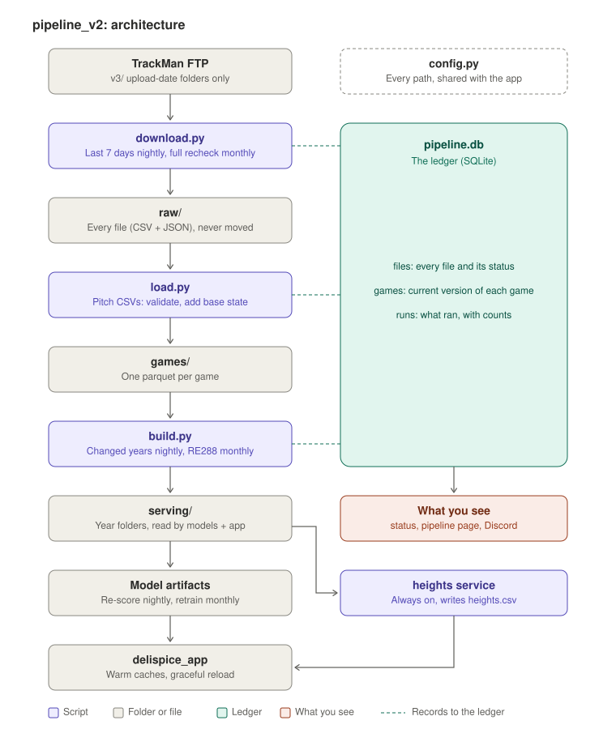
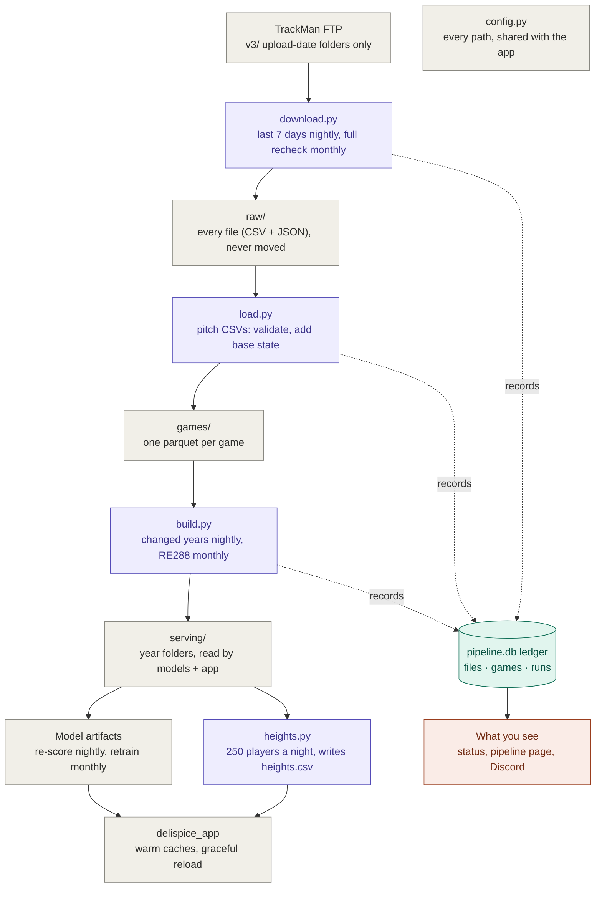
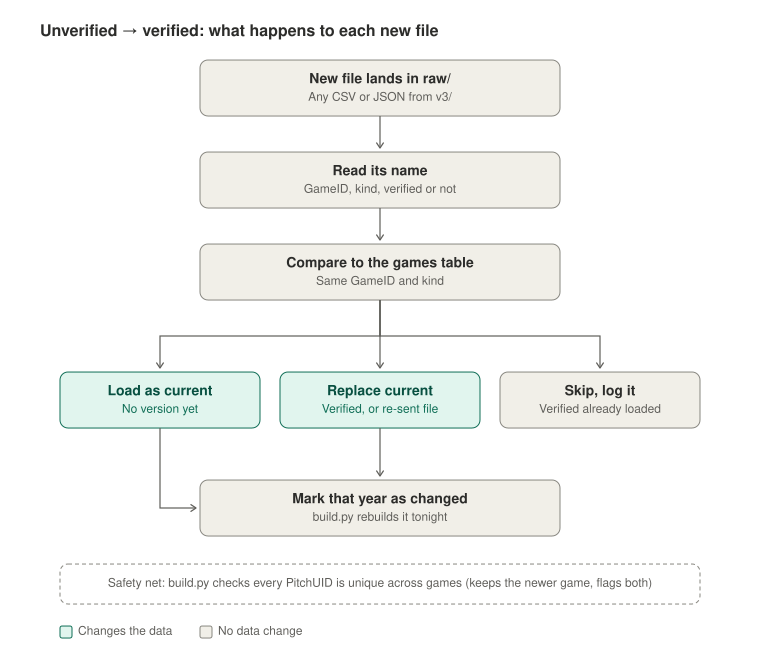
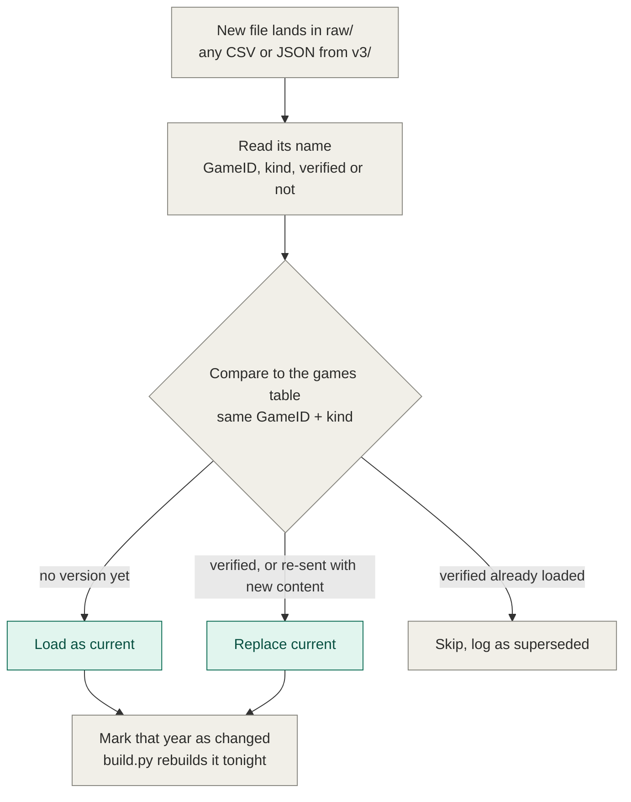

# pipeline_v2: the data_pipeline rewrite

Status (2026-10-10): **phases 0–5 and 3b done: the live site runs on v2 since 2026-10-10 00:41, the v2 nightly run and the heights service since 12:28.** The server runs `main` @ `9d6fb53`; the old crontab still runs (only its height scraper matters). Next: check the first unattended run (2026-10-11, `status`), then cleanup (phase 6) around 2026-10-17.

**Next session, start here: read §19 (handoff).** It says where everything is, how to run it, what phase 3 found, and the decisions settled on 2026-10-09 (§19.4) with the steps that follow from them (§19.5).

The new pipeline lives in its own folder, **`pipeline_v2/`** (code, this plan, `docs/`), built on the **`pipeline-v2`** git branch. The old `data_pipeline/` keeps running untouched until cutover and is deleted in the cleanup.

Guiding rule: **simple and efficient beats complex, and every file and run must be traceable.**

---

## 1. Why: what's wrong today

### How the current pipeline works

The server pipeline (`~/delispice/data_pipeline` on `mausington`) is two cron jobs linked only by the clock. A file's folder is its only record of status: each stage marks a file done by moving it into an archive subfolder.

| When | Job | What it does |
|---|---|---|
| 02:00 daily | `bash_scripts/factory.sh` | `lftp` downloads TrackMan's `/v3/<yesterday>/CSV/` into `data/unprocessed/`, deletes `*unverified*` / `*playerpositioning*` CSVs, moves the rest to `data/processed/`. JSON is left behind. |
| 03:00 daily | `run_pipeline.py` | 1. `pipeline_scaffold.py`: `data/*.csv` → read as text → convert types → add missing columns (201) → `fix_dictionary` → pandera validation → `clean/*.parquet`; source moved to `data/cleaned/`; failures copied to `quarantine/`. 2. `baserunner_state.py`: `clean/*.parquet` → adds `on_1b/on_2b/on_3b`, `base_state`, `re288_state` → `wbaserunners/{D1\|Others}/YYYY/MM/DD/`; source moved to `clean/processed/`. 3. `height_scraper.py`: up to 250 players/night from Baseball Reference → `heights.csv`. |
| 04:00 on the 1st | `run_pipeline.py --monthly` | Stages 1–3 again, then `compact.py` (merges `wbaserunners/` in place: past years → one file, finished months → one file) and `re_matrix.py` (→ `re_matrices/re288_matrix.{parquet,csv}`) |

Readers: `delispice_app` (`data.py`, `leaderboard.py`) and `backend/models` read `wbaserunners/`, `heights.csv` and the RE288 matrix.

### What's wrong

- **Broken since 2026-07-05.** Until then the pipeline lived in `~/delispice/backend/`, and cleaning read `backend/data/processed`. After the move to `data_pipeline/`, cleaning reads `data/*.csv` (top level only), but `factory.sh` still drops CSVs into `data/processed/`. 1,166 games (Jul 4 – Sep 22) are stranded, and the app's newest game is Jul 3. Every night logs "No CSV files found" and reports "failed stages: none". Only the height scraper still does real work.
- **Re-sent games would be double-counted.** TrackMan re-sends corrected games under the same name. `compact.py` appends daily files into existing month/year files without removing the old version. 16 of the stranded files share a name with games already processed, and 8 have different contents (e.g. `20260604-GoodallPark-2` grew from 254 to 303 lines).
- **Two height scrapers can overlap on the 1st.** The daily run ends ~3:51 and the monthly run starts at 4:00. Overlapping would double the request rate to Baseball Reference, near its ban threshold, with both appending to `heights.csv`.
- **Failures are invisible.** Stages are linked only by the clock, and finding zero files counts as success.
- **`factory.sh`:** not in git; every log line doubled (tee + cron redirect to the same file); off-season it tries to download the `practice` and `v3` folders and dies before logging "Run complete".
- **Bat-tracking JSON is downloaded and never used.** 1,959 files in `data/unprocessed/`, including nested `2026/MM/DD/CSV/` folders from an earlier download method.
- **Folder names mislead:** `data/processed` means "downloaded, waiting"; `data/cleaned` (the code's archive) is empty while the real 30,851-file history is in `data/cleaned_csvs`; `clean/` and `data/cleaned` are easy to mix up.
- **Height scraper:** only handles 403/429, so a Baseball Reference 500 crashed it on 2026-10-02 (progress was saved). `--backfill` never ran (`logs/backfill.out` shows a broken `~` path); all ~18.5k rows came from nightly runs.
- **Clutter:** ~150 per-worker logs in `logs/`; the `--monthly` docstring doesn't mention that the scraper runs again.
- **The app never picks up new data on its own** (see §8).

---

## 2. Facts checked against the data (2026-10-03)

| Question | Finding |
|---|---|
| Does `GameID` equal the filename key `YYYYMMDD-<stadium>-N`? | Yes, in 30,851 / 30,851 processed games. One `GameID` per file. |
| Does an unverified file keep the same key as its verified version? | Yes, 170 / 170 JSON pairs (`GameReference`). PitchUIDs were identical in every pair too. |
| Can `GameUID` be the key? | **No.** It changed between unverified and verified in 1 of 170 pairs. |
| How late do verified files arrive? | Median ~13 h after the unverified file, max ~19 days. |
| Can bat-tracking JSON join to the pitch CSV? | Yes. JSON `GameReference` = CSV `GameID`, JSON `SessionId` = CSV `GameUID`, and plays match on `PitchUID` and `PlayID` (272 / 272). |
| What's in the JSON? | Header plus `Plays[]`. BatSpeed/HAA/VAA are copies of CSV columns (58 / 58 identical). The new data is the swing path `BatPath.PreImpactSwing {Time, Barrel, UpperGrip}` (40–51 samples per swing) and raw camera tracks (`BatUnsmoothedXYZ`). Summer files are nearly empty (353 files, 0.08 MB average). Spring files (1,606, Feb–Jun 2026) average **9.4 MB**, with raw tracks on most plays and swing paths on ~15–30% of plays. All are Version 1.0.1. About 8% of 2026 games have a full-size JSON. |
| Name suffixes seen | `_unverified`, `_unverified_playerpositioning_FHC`, `_battracking`, `_unverified_battracking`. Stadium names can contain spaces and dots (`David F. Couch`). **All 91,469 names on the FTP match the §5 pattern** (FTP inventory, 2026-10-06). |
| Positioning files | `factory.sh` only ever saw 5, but the FTP holds **25,105** (1,640 verified, 23,465 unverified, 3.9 GB). We've never kept one, so the schema is unknown. |
| Can a pitch appear in two games? | Yes. Today's app data has 178 such `PitchUID`s (`20260221-` / `20260222-RiddlePaceField-1`, one game delivered under two dates). Serving every v2 game as is would give **56,411 in 381 game groups**: almost all pair a verified game with an unverified-only fragment or copy filed under another game number or date (e.g. `20240310-PioneerPark-6` is 23 pitches of `PioneerPark-2`; `20260704-Macon-1` is `20260629-Macon-1` with the wrong date). The §5 clash rule handles it. |
| Missing dates | 1,827 pitch rows have a null `Date`. |
| Quarantine history | 0 files quarantined in all 13 logged runs (the fix dictionary was built from a full scan). |
| Server model setup | Only `cq_D1` artifacts exist (Jul 11). `lightgbm` isn't installed, so eye can't train there. The Mac has cq/eye/eyescore/rvstate/xrv for D1 + P4. |
| FTP | TrackMan's FTP uses a **self-signed certificate** (why `factory.sh` disables verification). The password was never committed to git. The root has two folders, `v3/` (game files, by upload date) and `practice/` (contents not explored yet). |
| Column-count variants | Every FTP pitch CSV (63,790 stored, scanned 2026-10-08) has one of two layouts: **167 columns** (2022–2025) or **170** (2025–2026, adding `BatSpeed`, `VerticalAttackAngle`, `HorizontalAttackAngle`), both in exactly the schema's order, with no unknown columns. **No FTP file has the `SpinAxis3d*` block.** The 191 Mac CSVs that do (Cape Cod, Jun 13 – Aug 2 2026, 199 columns) came from another export; their FTP versions have the same pitches and identical values in every shared column. Nothing in the app or models uses the block. **The 32 `SpinAxis3d*` columns are dropped from the v2 schemas** (2026-10-08), which now hold exactly the 170 columns TrackMan sends, in its order; a 167-column file gets the 3 bat-tracking columns as nulls. If TrackMan ever sends the block, `load.py` reports it as new columns (§6). Those 191 games' SpinAxis3d values exist only in the Mac's old data. |
| Game counts per year | 3,047 (2022), 3,939 (2023), 5,317 (2024), 9,282 (2025), 10,432 (2026 so far) |
| Disk | 457 GB total, 302 GB free; the current data takes ~33 GB. |
| FTP inventory (2026-10-06) | `/v3`: 949 day folders (2022 – 2026-09-28), each with one `CSV/` subfolder holding every file type. **91,469 files, 38.9 GB**: pitch CSVs 34,512 verified (11.0 GB) + 29,874 unverified (8.9 GB); bat-tracking JSON 983 + 995 (15.1 GB); positioning 1,640 + 23,465 (3.9 GB). 88,273 unique names; 3,009 names delivered more than once (2,187 with a different size; max 6 copies). Upload lag (folder date − game date): median 1 day, p90 3, p99 256, max 1,640 days, so TrackMan re-sends old games into new folders. |
| FTP behavior | Login + encrypted transfers work with plain `ftplib` (self-signed cert, verification off; cert SHA-256 `5b940f17…6c6a`). MLSD returns size + modify time per file in one call (493 files in 0.5 s). Quirks: `OPTS MLST` is rejected (use the default facts), and MLSD lists `.`/`..` as `type=dir`. Supports `REST` (resume) and `XSHA256`. Speed: ~0.7 s fixed cost per file, ~5 MB/s on large files. |
| Raw file scan (2026-10-08, 63,790 pitch CSVs) | No missing or duplicate `PitchUID` inside any file, and `GameID` = the file name key in every file. **1,193 files are empty** (header only), all unverified; 1,175 games have nothing but empty files. 35,511 games: 26,086 with both versions, 6,174 verified only, 3,251 unverified only (2,076 of them with pitches). |
| `PitchUID` across versions (CSV) | Unverified → verified (26,086 games): identical in 71%, the verified version only adds pitches in 18%, and in **12% (3,069 games) some unverified `PitchUID`s disappear** (41,864 pitches; in 1,662 of those games every one has a same-position pitch in the verified file, i.e. a new ID). Re-sent versions: 74% identical, 14 games share none. So the JSON finding (170 / 170 identical) does not hold for CSVs. `Batter` / `Pitcher` change on 2.1% of pitches whose `PitchUID` stays the same (verification fixes names). The app's user data is unaffected: all 10 retags, 26,902 cluster assignments and 18,715 hand-confirmed pitches are in the versions v2 serves. |
| Repeated pitch positions | Pitches sharing (`Inning`, `Top/Bottom`, `PAofInning`, `PitchofPA`) with another pitch in the same file: verified 0.1% of files, unverified later verified 1.6%, **unverified never verified 11%** (229 of 2,076 games; 34,760 pitches). They are not copies (≈0% share pitcher, batter, call and speed): different pitches with broken numbering, likely extra tracking sessions. |

### Storage estimates

Measured per game: pitch CSV **0.32 MB**; spring bat-tracking JSON **9.4 MB** (~8% of games today); `games/` parquet **0.20 MB**; `serving/` **0.09 MB**. Gzip compresses CSVs 3.4× and JSON 2.7×.

**50,000 games, every verified file with an unverified counterpart, today's JSON coverage (~4,000 games with JSON):**

| | Keep every unverified | Delete unverified once verified arrives |
|---|---|---|
| Pitch CSVs | 32 GB | 16 GB |
| Bat-tracking JSON | 75 GB | 38 GB |
| `games/` | 10 GB | 10 GB |
| `serving/` | 5 GB | 5 GB |
| **Total** | **~122 GB** | **~69 GB** |

- `games/` and `serving/` hold only the current version of each game, so the difference is entirely in `raw/`.
- Unverified CSVs cost only ~16 GB. **JSON is the variable that matters:** if bat tracking reaches every game, verified JSON alone is ~470 GB (~940 GB keeping unverified).
- Compression saves more than deleting: ~52 GB keeping everything compressed, ~34 GB deleting + compressing, ~195 GB even with JSON for every game.
- 50,000 games is ~2028 at ~11k games/year, not 5 years out.
- **Keeping everything:** ~45 GB for today's ~32k games (JSON only exists for 2026), then ~27 GB/year at the 2026 pace. That's roughly **10 years** of disk at today's JSON coverage, but **~1.5 years** if every game gets bat-tracking JSON. `status` tracks this (§9).

---

## 3. Design principles

1. **Raw files are immutable.** Each lands once in `raw/` and never moves.
2. **One ledger for status.** `pipeline.db` (SQLite) records every file, every game's current version, and every run. A file's location never encodes its status.
3. **One file per game** in `games/`. Replacing a game means overwriting that one file, so duplicates can't happen.
4. **`serving/` is always derived.** It's rebuilt from `games/` and can be thrown away at any time. **The app reads only `serving/`**, never `games/`.
5. **One `config.py`** for every path, imported by both the pipeline and the app.
6. **One schedule, one lock.** Nothing can overlap.
7. **Only convert what we use.** Positioning CSVs and bat-tracking JSON are kept and tracked in the ledger, but not converted until there's a use for them.

---

## 4. Architecture



<details>
<summary>Text version (Mermaid, for future sessions and plain-text readers)</summary>



</details>

Purple = script, gray = folder or file, teal = the ledger, coral = what you see. Dashed lines = each step records what it did in the ledger. `config.py` holds every path and is imported by both the pipeline and the app.

### Folder layout

```
pipeline_v2/
  config.py                    every path + setting, imported by the pipeline and the app
  plan.md, docs/               this plan and its diagrams (tracked)
  .env                         FTP login + Discord webhook (never committed)
  pipeline.db                  the ledger (SQLite)
  raw/YYYY/MM/DD/<original>    exact FTP copy: pitch csv, positioning csv, json
  games/YYYY/<GameID>.parquet  one per game (pitch data + base state)
  serving/pitches/{D1,Others}/YYYY/<level>_YYYY.parquet   e.g. serving/pitches/D1/2026/d1_2026.parquet
  serving/re288_matrix.parquet
  heights.csv                  moves here from data_pipeline/ at cutover
  logs/runs/YYYY-MM-DD.log     one log per run, kept (~1 MB/year)
  logs/workers/YYYY-MM-DD/     worker logs, auto-deleted after 1 year
```

**Why the year is a folder:** every reader in the app and models finds files as `<base>/<D1|Others>/<year>/**/*.parquet`, and checks that `<base>/<part>/<year>` is a directory. Mirroring today's yearly compacted layout keeps all of those globs working unchanged, so the app only needs its base path switched (§11).

**How reads work:** the app and models read `serving/`: a few large files, one per level and year, just like today's compacted `d1_2025.parquet`. Nothing is combined while a user waits. `build.py` combines per-game files into `serving/` at night, only for years that changed. Thousands of small files would make every query slow, which is why compaction exists. Keeping `games/` costs ~2.7 GB of extra disk; in return, replacing a game is one file overwrite and a full rebuild is fast.

### Modules (~8, replacing 12 files)

| Module | Job |
|---|---|
| `config.py` | Paths and settings (also imported by `delispice_app` and `backend/models`) |
| `ledger.py` | SQLite schema and helpers |
| `names.py` | Filename parser (checked against every real name from the logs) |
| `download.py` | FTP → `raw/` + ledger. **Only reads the `v3/` tree**; `practice/` is skipped for now. FTP password read from `.env`. A file is fetched when its (remote path, size, modified time) isn't in the ledger. Writes `<name>.part`, checks the size, hashes while streaming, renames into `raw/YYYY/MM/DD/`. Identical re-delivery (same name + sha256) → `duplicate` row pointing at the first copy, no second copy stored; same name re-uploaded into the same folder with new contents → kept as `<stem>__<modified><ext>`. Nightly window = folders from the last 7 days, reaching further back if the last successful run was longer ago. Flags: `--all`, `--since/--until`, `--workers`, `--limit`, `--dry-run`. |
| `load.py` | Pitch CSVs in `raw/` → `games/`: the existing cast → fix → validate path plus baserunner state, **including `next_re288_state` and `half_complete`** (§8, run value), with the baserunner fixes in §18 |
| `build.py` | `games/` → `serving/` (changed years only), `PitchUID` uniqueness check, RE288 matrix |
| `heights.py` | The current scraper wrapped in a loop for the always-on service |
| `run.py` | `python -m pipeline_v2 run \| status \| backfill \| rebuild` |
| copied from `data_pipeline/` | `trackman_schema.py`, `trackman_pandera_schema.py`, `fix_dictionary.py`, baserunner logic (the old copies stay with `data_pipeline/` until cleanup) |

### Ledger sketch (`pipeline.db`)

- **files** (one row per downloaded copy): `file_id, remote_path, ftp_size, ftp_modify, folder_date, name, path, sha256, game_id, kind (pitches/positioning/battracking/unknown), verified, status (new/duplicate/loaded/superseded/tracked/failed/unknown, plus `empty` and `held` from phase 2, §6), error, rows, rows_dropped, warnings (json), first_seen, run_id`; unique on (remote_path, ftp_size, ftp_modify). Schema lives in `ledger.py`.
- **games**: `game_id, kind, current_file, verified, level, year, game_uid, rows, updated_at, excluded, note`. One row per (game_id, kind). For positioning/battracking, `current_file` points into `raw/`.
- **runs**: `run_id, job, args (json), started, finished, status (running/ok/failed), counts (json), error, log_path`
- **clashes** (rewritten by every build): `held_game, kept_game, shared, rule, run_id`: games held out of `serving/` because they share `PitchUID`s with a served game (§5)
- **serving**: `part, year, path, fingerprint, games, rows, built_at, run_id`: one row per year file; the fingerprint (its games, their current files, when each was written) is how `build.py` skips unchanged years
- All paths are stored **relative to the data folder**, so `raw/` + `pipeline.db` can be copied between machines as-is.

**Why SQLite for the ledger:** DuckDB stays, for querying parquet in the app. The ledger is bookkeeping: thousands of tiny inserts and updates, read by `status` and the pipeline page while the pipeline writes. SQLite allows readers while one process writes; a DuckDB database file can't be opened by a second process at all while someone is writing to it. SQLite is also built into Python and already used for shortlists. DuckDB can still query the ledger with `ATTACH 'pipeline.db' (TYPE sqlite)`.

---

## 5. Unverified → verified rule



<details>
<summary>Text version (Mermaid)</summary>



</details>

- Name pattern: `YYYYMMDD-<stadium>-N[_unverified][_playerpositioning|_battracking][_variant].csv|json`
- The key is the **filename key = `GameID`**, never `GameUID`.
- A verified file always wins. An unverified file never replaces a verified one. A re-sent file with a new sha256 replaces the current version.
- **Empty files** (header only) are never loaded and never replace a game: ledger `status = empty`.
- **Unverified games are served only when clean:** they have pitches, no repeated pitch positions, and no `PitchUID` shared with another served game (§6). Otherwise they are held back until a verified version replaces them.
- The losing file is marked `superseded` in the ledger; its raw file is kept.
- The same rule tracks the current positioning/battracking file per game (ledger only, no conversion).
- Every serving row carries `is_verified` and `source_file`.
- **Safety net: one pitch, one served game.** `build.py` checks that each `PitchUID` appears in only one served game. On a clash: (1) a verified game beats an unverified one, and the unverified game is held back entirely (in the 2026-10-08 data these are fragments or copies of the verified game under another number or date); (2) between two unverified games, keep the one that contains the other; (3) between two verified games, keep the most recently delivered. Every clash is shown in `status` and recorded in the ledger (the held-back game and the game it clashes with). Override by setting `excluded` in the ledger.
- **`PitchUID` stays exactly as TrackMan sends it.** No composite or altered key: names change on verification (2.1% of pitches), so adding `Batter` / `Pitcher` would match worse than `PitchUID` alone. One version of each game is served, so an ID that changes between versions can't double-count. When a game's file is replaced, `load.py` records in the ledger how many `PitchUID`s carried over, appeared and disappeared (shown in `status`). Score caches (xRV, eye) refill through the nightly re-score. Retags and cluster confirmation are allowed only on verified pitches (App edit 8), so verification can't orphan them; both features are being retired.

### Why GameID, not GameUID

| | `GameID` | `GameUID` |
|---|---|---|
| Example | `20260529-PKPark-1` | `f2121665-6fc9-4089-b74d-eb0ca1efe0e3` |
| What it is | Date, stadium and game number: the same text as the filename | A random ID TrackMan creates per recording session (`SessionId` in the JSON) |
| Matches the filename | 30,851 / 30,851 | Never |
| Same in unverified and verified versions | 170 / 170 | 169 / 170 |

1. **The verified rule is defined by filenames.** TrackMan pairs files by name (same name minus `_unverified`), so the pairing rule and the database key are the same thing.
2. **`GameUID` broke once.** Keyed on `GameUID`, that verified file would look like a new game, both versions would load, and the game would be counted twice: the exact bug being designed out.
3. **The key is known before opening the file**, even from the FTP listing. That matters for positioning and JSON files, which the ledger tracks without opening.
4. **It's readable** in the ledger, logs and error messages.

**What it can't catch:** TrackMan delivering one game under two names (Riddle Pace Field as both `20260221-` and `20260222-`). `GameUID` wouldn't catch that either, because the copies had different `GameUID`s. The `PitchUID` uniqueness check covers it. `GameUID` stays as a column; the RV state builder sorts by it, which is safe because only one version of each game exists in `serving/`.

---

## 6. Validation and quarantine policy

### Today

- **The whole file is skipped** (copied to `quarantine/` with a reason note, original left in place, retried and re-copied every night) when:
  - it's unreadable
  - a required column has a null: `PitchUID`, `GameID`, `GameUID`, `Pitcher`, `PitcherTeam`, `BatterTeam`, `CatcherTeam`, `HomeTeam`, `AwayTeam`, `Stadium`, `Inning`, `Outs`, `Balls`, `Strikes`, `OutsOnPlay`, `RunsScored`, `Top/Bottom`, `PitcherSet`, `TaggedPitchType`, `KorBB`, `TaggedHitType`, `PlayResult`
  - a categorical value isn't in its allowed list after typo fixes
  - a column has the wrong type
- **Row-level:** rows with impossible counts (Outs 0–2, Balls 0–3, Strikes 0–2, PitchofPA 1–25, OutsOnPlay 0–3, RunsScored 0–4 are allowed) are dropped **without being counted**. Uncastable numbers become null with a warning. Extra columns are dropped and missing ones added as nulls. Typos are remapped by `fix_dictionary.py`, which documents ~22,000 bad cells across 9.2M rows, mostly `CatcherThrows`.
- A failing file never stops the others, and the stage still exits successfully, so quarantines are visible only in `pipeline.log`.
- **12 columns have allowed lists:** `Top/Bottom`, `PitcherThrows`, `BatterSide`, `CatcherThrows`, `PitcherSet` (only `Undefined`!), `TaggedPitchType`, `AutoPitchType`, `PitchCall`, `KorBB`, `TaggedHitType`, `PlayResult`, `AutoHitType`. A single new TrackMan value would block every new file while the run reports success.

### v2

| Problem | Action |
|---|---|
| Unreadable file; a missing or null key column (`PitchUID`, `GameID`, `Inning`, `Outs`, `Balls`, `Strikes`, `Top/Bottom`); duplicate `PitchUID` inside a file | **Fail the file.** Ledger `status=failed` + error. Not loaded; shown in `status`. |
| Value not in an allowed list (new pitch type, typo, new `PitcherSet`) | **Load it** (load + warn), keep the value, record `column → value → count` in the ledger `warnings`. `status` and the Discord alert list new values so they can be added to the allowed lists or the fix map. |
| Uncastable number | Set to null (as today) and count it in `warnings`. |
| New column TrackMan added (not in the 170-column schema) | Load the game without it (the raw file keeps it), record the column in the ledger, and **ping it in `status` and Discord** so it can be added to the schema. |
| Impossible count (Outs 3, Balls 4…) | Drop the row (as today) and **count it** in `rows_dropped`. |
| More than half the rows have impossible counts | **Fail the file**: a bullpen or practice session filed in a game slot (one "at-bat" of hundreds of pitches, usually no strikeouts, walks or balls in play). Before, the leftover ≤25 rows loaded as a fake game. 59 files on 2026-10-08; it removes 3 such 25-pitch fragments from today's app data. |
| Empty file (header only) | **Don't load.** Ledger `status=empty`; never replaces a game; not counted as a failure. |
| Unverified file with repeated pitch positions | **Hold back** (`status=held`, with the count): not loaded until a verified version replaces it. Shown in `status`. |
| Unverified game sharing a `PitchUID` with another served game | Held back by `build.py` (§5 clash rule). |

No more quarantine copies: the raw file stays in `raw/`. After updating the allowed lists or fix map, one command reruns the affected games from `raw/`: `run --retry-failed` for failed files, `run --reload-warned` for games that loaded with warnings (or `run --reload <GameID>` for specific games). New values also go out in a Discord alert (phase 2).

### Why load + warn

| Columns | What uses them |
|---|---|
| `PitchCall`, `KorBB`, `PlayResult`, `Top/Bottom` | Base-state reconstruction → RE288 → RV; xRV training labels (`PlayResult`); eye swing/take (`PitchCall`) |
| Everything else (pitch types, handedness, `PitcherSet`, hit types) | Display and grouping in reports |

Example: TrackMan starts sending `PlayResult = "Interference"`.
- **Fail the file:** every game with that play is withheld until the value is added. Nothing wrong is shown, but a common new value would hold back most new games.
- **Load + warn (chosen):** the games show up. On that play the base-state model leaves the bases unchanged, so the rest of that half-inning might carry a wrong base state: a tiny RE288/RV error. `status` shows "PlayResult: Interference ×3 in 3 games". Add the value, run `--reload-warned`, and the error is gone.
- **Fail only for the four base-state columns:** the conservative alternative, protecting run math exactly at the cost of withholding games whenever those columns get a new value.

Load + warn is safe because `raw/` never changes and loading is repeatable, so every choice is reversible. It matches the priorities of fresh data (the reason unverified files are kept) and seeing exactly what's going on (the warning list).

---

### When something fails

The app keeps serving yesterday's data, and nothing partial is ever published.

- **A step fails** (FTP unreachable, a crash, disk full, a build error): the run stops. Nothing from that night is published: `serving/` isn't rebuilt, and the app isn't warmed or reloaded. The next night's run retries everything; the 7-day re-check window is the redundancy.
- **Publishing happens only at the end:** `serving/` is rebuilt and the app reloaded only after every step succeeded.
- **Every write is atomic:** downloads go to a `.part` file and are renamed when complete; parquet files are written to a temporary file and renamed. The app and heights service never read a half-written file.
- **One file fails validation** (unreadable, a missing key column): **skip just that file and flag it** (ledger `status=failed`, shown in `status`/Discord) and publish the rest. Otherwise one corrupt TrackMan file would block every new game every night until fixed. Each game is still all-or-nothing: never half-loaded.

---

## 7. Parallelism

| Step | Parallel? |
|---|---|
| `download.py` | Nightly: one connection (a few hundred files). **Backfill: 3 connections** (the number tested), because the ~0.7 s per-file cost makes 91k files take ~15–20 h on one. |
| `load.py` | **Yes: a process pool, one worker per CPU (12 on the server).** Same code path for the bulk (~32k files, ~30 min) and nightly (hundreds of files, seconds). Workers write `logs/workers/<date>/` and return their results to the parent, which records them in the ledger and run log. |
| `build.py` | Polars' own multithreading (scan → sink per year); no worker processes |
| Model training | One (level, year) at a time; sklearn/LightGBM use threads internally (memory limits parallel fits) |
| Heights | One request at a time by design (rate limit) |

Worker logs are kept (deleted after 1 year); the ledger and run log hold the summary.

---

## 8. Schedule and app refresh

| When | What |
|---|---|
| 03:00 nightly (one cron line, `flock`); imports the previous day's uploads | download (**upload folders from the last 7 days under `v3/`, reaching back to the last successful run after missed nights**) → load → build (changed years) → re-score new pitches → warm app caches → reload app → write status |
| 1st of the month (same run, after nightly) | **full FTP recheck** (list every `v3/` folder, download anything missing or changed) → rebuild RE288 → retrain models (every level; **current season + any past year whose games changed that month**) → re-score → reload app |
| Nightly, last step of the run | heights: one batch of 250 players (~350 requests, ~40 min) at ~6.5 s/request, D1 first; a 5xx/timeout skips the player, 5 in a row end the batch; 3× 403/429 end it and stop all requests for 3 days. *(An always-on service was tried 2026-10-10 and BR blocked it after ~1,000 requests in 2 h; BR limits volume, not just requests per minute. The old 250-a-night pace ran three months unblocked.)* |

One run a day at 03:00. Verified versions usually arrive mid-afternoon, so they're picked up the next night; there's no second daily run. Monthly retraining happens in the same early-morning run. With today's user count, memory overlap between training and the app isn't a concern; revisit if traffic grows.

### How it runs (no bash)

The only shell left is one crontab line:

```bash
0 3 * * * cd ~/delispice && flock -n /tmp/delispice-pipeline.lock .venv/bin/python -m pipeline_v2 run >> pipeline_v2/logs/cron.log 2>&1
```

`download.py` (Python) replaces `factory.sh` (bash + `lftp`) because:
- It has to talk to the ledger: for every FTP file, check whether it's known, compare size and modified time, and record the result. That's a few lines in Python and awkward in bash.
- One language and orchestrator means errors, retries and logging work the same way in every step.
- It's testable and lives in git (the password stays in an uncommitted file).
- Python's built-in `ftplib` handles FTPS with the self-signed certificate; nothing extra to install.
- Phase 1 confirmed TrackMan's server supports MLSD listings (sizes and times in one call), so no per-file fallback was needed.

### Why the app needs a refresh

The app caches in two places:
1. **Disk caches** in `delispice_app/.cache`: the picker index (players/teams/years), percentile pools, leaderboard pools. They're built once and reused until deleted. Today the "⟳ Rebuild index" button rebuilds them, so even a working pipeline wouldn't show new players or move percentiles until someone clicks it.
2. **In-memory caches** in the running gunicorn process: per-player report rows, scored rows, the RE tables, RV state tables, loaded cq/eye models. The button doesn't touch these; only a fresh process clears them.

**How:** the pipeline rebuilds the disk caches first (warm), then sends gunicorn a graceful reload: `kill -HUP $(systemctl show -p MainPID --value delispice)`. Gunicorn starts a fresh worker and lets the old one finish its requests (graceful-timeout 30 s), so there's **no downtime**. The gunicorn master runs as `mausington`, the same user as the pipeline, so **no sudo is needed**. This replaces the app's "⟳ Rebuild index" button (see §11).

**In-memory cache sizes** (measured 2026-10-03 on the server: the worker uses **1.1 GB** after 40 days running and peaked at **9.7 GB**; the machine has 14 GB):

| Cache (in the running app) | Holds up to | Estimated size when full |
|---|---|---|
| Picker index (pitcher + batter) | 2 tables | ~10–30 MB |
| `_rows_cached` / `_scored_cached` | 64 player selections each | ~100–300 MB each |
| `percentile_pool` + leaderboard `pool` | 16 pools each | < 100 MB combined |
| `_cq_model` (k-NN keeps its training points) | 16 level-years | ~5–10 MB each |
| `_xrv_cache` (PitchUID → xRV) | 16 level-years | ~30 MB each (D1) |
| `_eye_model` | 16 level-years | a few MB each |
| `_eye_cache` (PitchUID → eye, every pitch) | 4 level-years | ~140 MB each |
| `rv_store.state_lookup` | 2 seasons | ~139 MB each (per its own comment). **Goes away** with the run-value change below. |
| `re_lookup`, `team_maps` | — | tiny |

If every cache were full, that's roughly **1.5–2 GB**. The 9.7 GB peak comes from DuckDB's working memory during heavy queries (index and pool builds), capped by `DUCKDB_MEMORY_LIMIT=10GB` in the service, not from these caches. The nightly reload is about stale data, not memory, though it also returns that memory every night.

### Models (every level)

| Model | Uses RE288 | Monthly | Nightly |
|---|---|---|---|
| Contact quality / xRV (`cq_store`) | in training | retrain | `--xrv-only` re-score (~20 s per season) |
| Eye (`eye_store`) | baked into scores | retrain | `--eye-only` re-score |
| RV (`rv_store`) | applied when read | nothing to retrain | nothing: `next_re288_state` is written by `load.py` with each game (see below) |

Retrain monthly, re-score nightly; without the nightly re-score, new games would have blank or live-computed values for up to a month.

### Run value: store the facts, compute the value

The pitch data stores **facts**, never run values, so **the RE matrix changing never requires rewriting `games/` or `serving/`.**

```
run value = runs scored on the pitch + RE(state after) − RE(state before)
```

Example half-inning (made-up RE numbers):

| Pitch | State before | What happened | State after | Run value |
|---|---|---|---|---|
| 1 | `000\|0\|0-0` (empty, 0 out, 0-0) | ball | `000\|0\|1-0` | 0 + 0.55 − 0.50 = +0.05 |
| 2 | `000\|0\|1-0` | single | `100\|0\|0-0` (runner on 1st, next batter) | 0 + 0.88 − 0.55 = +0.33 |
| 3 | `100\|0\|0-0` | double play | `000\|2\|0-0` | 0 + 0.10 − 0.88 = −0.78 |
| 4 | `000\|2\|0-0` | fly out, inning over | none (worth 0) | 0 + 0 − 0.10 = −0.10 |

The "state after" is the next pitch's state, which often belongs to a different batter. A player's report loads only that player's pitches, so the state after must be worked out by something that sees the whole game.

- **Today:** a separate season-wide step (`rv_store`) builds `rvstate_<year>.parquet` (PitchUID → state before, state after, runs). It's rebuilt when games change; the app loads it (~139 MB per season in memory), joins by PitchUID, then looks up RE values.
- **v2 (decided):** `load.py` already walks each game pitch by pitch, so it writes **`next_re288_state`** next to `re288_state`, plus a **`half_complete`** flag (the half-inning recorded 3 outs, counting strikeouts; RV stays blank when it didn't, the same rule `rvstate` applies today). The state after is computed within (game, inning, top/bottom), same as today. Every `serving/` row then carries both states; the app looks up RE for both columns and subtracts.

| | Today | v2 |
|---|---|---|
| Where the state after is computed | a separate season-wide step | `load.py`, while reading each game |
| Where it's stored | `rvstate_<year>.parquet` | two columns in the pitch data |
| When a game is added or replaced | rebuild that season's file | nothing extra; the game's file is written anyway |
| When the RE matrix changes | nothing | nothing (states are facts, not values) |

The "Change run environment" picker keeps working: run values still aren't stored, and the RE matrix is still chosen when the data is read. What goes away: the `rvstate` files, their nightly rebuild, and the ~139 MB-per-season cache. Cost: an App edit (§11, item 7).

**Options considered for serving models:**

| Approach | Speed when a user asks | Verdict |
|---|---|---|
| Train on request | Minutes (cq scans a full season and fits k-NN; eye fits three LightGBM models), and needs the whole league's data | Too slow |
| Saved model, score on request | Fine for one player's report; slow for leaderboards | Kept only as the fallback for pitches missing from the score table |
| **Saved model + precomputed score table (current)** | Instant lookup by PitchUID | **Keep** |
| Write scores into `serving/` as columns | Instant, but every model change forces a data rebuild | No: ties data and models together |
| Separate model service | — | Overkill for one box |

- Artifacts per (level, year), in `backend/models/artifacts/` (small; space isn't a concern):
  - **cq:** `cq_<level>_<year>.npz` + `.json` (model), `xrv_<level>_<year>.parquet` (scores)
  - **eye:** `eye_<level>_<year>_{ump,swing,ev}.txt` (three LightGBM models) + `.json`, `eyescore_<level>_<year>.parquet` (scores)
  - **RV:** no artifact in v2. The two states live in `serving/`. (Today: `rvstate_<year>.parquet`.)
- The app loads the model (`_cq_model` / `_eye_model`) and the score table (`_xrv_cache` / `_eye_cache`), joins scores by PitchUID, and live-scores only pitches missing from the table. With no model trained, the column is blank. That's the case for eye on the live site today (no eye artifacts and no `lightgbm` on the server).
- The training CLIs default to `--level D1`; run them for every level.
- **RE288 and model training use verified games only** (decided 2026-10-08). RE288 counts extra innings at every level: the old matrix dropped them outside D1 because of the ghost runner, which is now placed only where it's used (§18), so those states are real. Unverified games are served for display (with the badge) but never feed the matrix or the models.
- Train for **every Level × year with data, plus P4**. Levels as of 2026-10-03:

  | Level | Pitches | Games | Years |
  |---|---|---|---|
  | D1 | 7,210,610 | 23,417 | 2022–2026 |
  | D2 | 473,183 | 1,651 | 2022–2026 |
  | JUCO | 286,608 | 1,042 | 2022–2026 |
  | D3 | 251,022 | 838 | 2022–2026 |
  | WCL | 222,595 | 725 | 2025–2026 |
  | NWL | 197,401 | 630 | 2025–2026 |
  | CPL | 165,535 | 542 | 2025–2026 |
  | NAIA | 135,038 | 474 | 2024–2026 |
  | NECBL | 131,537 | 437 | 2025–2026 |
  | USA Baseball | 103,984 | 430 | 2025–2026 |
  | Cali Collegiate | 97,670 | 316 | 2025–2026 |
  | Cape Cod Baseball League | 86,872 | 298 | 2025–2026 |
  | Area Code Games | 9,536 | 38 | 2025 |
  | East Coast Pro | 2,937 | 12 | 2025 |
  | TeamExclusive | 328 | 1 | 2022 |

- Thin levels: build anyway, record the row count with each artifact, and handle them later.
- Install `lightgbm` on the server (via requirements, §10) before eye can train there.

---

## 9. Tracking: `python -m pipeline_v2 status`

- Last run of each job and whether it succeeded
- File counts by status and kind
- Newest game per level; how many games are still unverified
- Failed files with errors; new category values; dropped-row counts
- Duplicate `PitchUID`s; unknown file types
- Held-back unverified files and games (with the reason and the clashing game); empty-file count; `PitchUID` carry-over on replaced games
- Heights queue size, request rate, last block
- Age of each model artifact vs the RE288 matrix
- New columns TrackMan added (not in the schema)
- Disk usage, growth per month, and projected months until the disk is full (alert at 80% full)

**Alert:** during the season, two nights in a row with zero new files fails the run, instead of reporting success. "Season" is a calendar window in `config.py`, default **Feb 1 – Aug 31**.

The same report appears on the app's pipeline page (§11) and feeds the Discord alerts (wired in phases 2, 3b and 7).

---

## 10. Other fixes

1. **Hardcoded paths.** Seven files read the pipeline output by hardcoded path. Only pipeline scripts write it: `baserunner_state.py` creates the daily files, `compact.py` rewrites them in place, and `re_matrix.py` writes the RE288 matrix.

   | File | Reads |
   |---|---|
   | `delispice_app/data.py` | `wbaserunners/` (index, reports, pools), `heights.csv` |
   | `delispice_app/leaderboard.py` | `wbaserunners/` (imports `WBASE` from data.py) |
   | `backend/models/contact_quality.py` | `wbaserunners/`, `re288_matrix.parquet` |
   | `backend/models/eye_v1.py` | `wbaserunners/`, `re288_matrix.parquet` |
   | `backend/models/rv_store.py` | `wbaserunners/`, `re288_matrix.parquet` |
   | `backend/models/autotagger.py` | `wbaserunners/` |
   | `data_pipeline/height_scraper.py` | `wbaserunners/`, `backend/models/team_acronyms.csv` |

   The risk is the reverse of July's break: when v2 moves the output to `serving/`, a missed reader keeps reading stale data without erroring. `config.py` makes it a one-place change.
2. **Pinned dependencies.** The root `requirements.txt` is the single pinned list for the shared venv; **update it whenever a dependency is added.** First additions (**done in phase 0**): `pandera==0.32.0` and `pandas==3.0.3` (today only in an untracked, unpinned `data_pipeline/requirements.txt` on the server, to be deleted), and a version pin for `lightgbm` (`4.6.0` on the Mac; not installed on the server). Pinning also lines up the Mac (pandas 3.0.2) with the server (3.0.3) so local tests mean something.
3. **Secrets:** the FTP password and the Discord webhook URL stay in uncommitted files (never in git). `download.py` is committed and reads the password from its file.
4. **A missed night loses files forever:** fixed by the 7-day window plus the monthly full recheck.
5. **The RE288 matrix is tracked in git** (`.gitignore` re-includes `data_pipeline/re_matrices/`), but the server's monthly job rewrites it. The server's copy currently shows as modified in `git status`, so the next `git pull` that changes those files will refuse to run. It's derived data: stop tracking it in phase 0 (`git rm --cached` + drop the `.gitignore` exception). v2 writes `serving/re288_matrix.parquet`, which isn't tracked.
   - **Why the pull refuses:** git won't overwrite uncommitted changes. If a commit touches the matrix while the server's copy is modified, the whole pull aborts, blocking every other change in it.
   - **The real danger is the quick fix:** `git checkout -- <file>`, `git stash` or `git reset --hard` would swap the server's fresh matrix for the older committed one, and the app would use a stale RE table without any error.
   - **The server runs fine untracked:** the app reads the file by path; git tracking doesn't affect that (like `wbaserunners/`, `heights.csv` and the artifacts today).
   - **Untracking trap:** to the server, the untracking commit means "file deleted", so pulling it removes the server's copy (and the pull refuses while the copy is modified). Safe order on the server: (1) copy both matrix files aside, (2) `git checkout -- data_pipeline/re_matrices/`, (3) `git pull` (removes them, **and the now-empty folder**), (4) `mkdir -p data_pipeline/re_matrices` and copy them back (now untracked and ignored). Fallback: rerun `re_matrix.py` (~1 min). **Done 2026-10-06** (the temporary backup was deleted after confirming the restored files matched).
6. **`deploy/delispice.service` is also locally modified on the server** (setup filled in the username). Same pull hazard if the template ever changes upstream; keep in mind when editing it.
7. **Installing packages can break the live app.** The app and pipeline share one venv, so installing `lightgbm`, `pandera` or `pandas` can quietly upgrade shared libraries (numpy, scipy) under the running app. Rule: install only from the pinned `requirements.txt`, test that exact install on the Mac first, then click through the live app after installing on the server.

---

## 11. Edits to App

Changes to `delispice_app` (and `backend/models`) outside the pipeline itself.

**Where the pipeline and the app meet.** The pipeline never edits app code. They connect at three points:
- **The app reads pipeline output:** pitch data, the RE288 matrix, `heights.csv`. These paths need rewiring (items 3–4).
- **The pipeline runs the model CLIs** (`cq_store`, `eye_store`). They write artifacts to `backend/models/artifacts/`, where the app already looks; no change.
- **The pipeline refreshes the app:** it calls the app's own cache-building functions (warm), then a graceful reload (§8).

New `serving/` columns (`is_verified`, `source_file`) don't break anything: the app selects named columns or uses `SELECT * … union_by_name`.

1. **Remove the "⟳ Rebuild index" button.** Delete the button (`app.py` layout, `refresh-btn`) and its `cb_refresh` callback. The nightly pipeline now does this refresh (warm caches + graceful reload, §8). Keep `data.get_index(force_rebuild=True)`, `data.clear_percentile_pools()` and `leaderboard.clear_pools()`: the pipeline's warm step calls them.
2. **Move user data out of `.cache`.** Move `retags.json` (manual pitch retags) and `autocluster.json` (GMM runs, cluster names, hand-confirmed pitches) to `delispice_app/state/` (`config.APP_STATE_DIR`), by changing `RETAG_PATH` and `AUTOCLUSTER_PATH` in `data.py`. `.cache` is then always safe to delete. A copy still in `.cache` is moved over automatically on first start, so the server needs no manual step. **Done (phase 0).**
3. **Read paths from `config.py`** (phase 0, no behavior change: `config.py` still points at today's paths). Replace the hardcoded constants with `from pipeline_v2 import config` (`config.PITCHES_DIR`, `config.RE288_PATH`, `config.HEIGHTS_CSV`):
   - `delispice_app/data.py`: `WBASE`, `HEIGHTS_CSV`
   - `backend/models/contact_quality.py`: `PIPELINE`, `REM_PATH`
   - `backend/models/eye_v1.py`: `PIPELINE`, `REM_PATH`
   - `backend/models/rv_store.py`: `PIPELINE`, `REM_PATH`
   - `backend/models/autotagger.py`: `PIPELINE`

   `leaderboard.py`, `cq_store.py` and `eye_store.py` import those constants, so they follow automatically. **Done (phase 0).**
4. **Point the app at `serving/`** (phase 5, cutover). Flip `config.PITCHES_DIR`, `config.RE288_PATH` and `config.HEIGHTS_CSV` to their v2 values (noted in `config.py`). The only code change: the picker index extracts `Part` with a hardcoded `regexp_extract(filename, 'wbaserunners/([^/]+)/', 1)` (`data.py`). Build that pattern from the configured folder name instead. Every glob keeps working because `serving/` keeps the year folders (§4).
5. **Show an "unverified" badge** on games whose rows have `is_verified = false`.
6. **Pipeline page, behind the shortlist login.** A small page showing the `status` report (last runs, newest game per level, failures, new values, new columns, heights queue, disk), read from `pipeline.db`, so you can check without SSH. Only signed-in contributors (the existing initials + password login) can see it, because the site is public and `status` shows file names, errors and paths.
7. **Run value from the row's own columns** (phase 5, cutover). Change `rv_store.attach_rv` to look up RE for the rows' `re288_state` and `next_re288_state` (blank when `half_complete` is false; RE after = 0 when the half-inning ended), instead of joining `rvstate_<year>.parquet` via `state_lookup`. Update its call site in `data.py` and the leaderboard's RV query (`leaderboard.py` joins the `rvstate` files by PitchUID). Remove `state_lookup`, `build_state_cache` and the `rvstate` CLI.
8. **Retags and cluster confirmation on verified pitches only** (phase 5, cutover). The retag and AutoCluster actions skip rows with `is_verified = false`, and the app says why. Both features are slated for retirement, so this is a small guard, not new work.

---

## 12. Admin steps (run by Matt; Claude provides copy-paste commands)

- Install the heights systemd unit (`sudo cp … /etc/systemd/system/`, `daemon-reload`, `enable --now`). Only after the old crontab is removed (§14).

---

## 13. What goes away

The **whole `data_pipeline/` folder** once `heights.csv` has moved to `pipeline_v2/`: `factory.sh`, `compact.py`, `serving.py`, the `rvstate_<year>.parquet` artifacts and their rebuild step, `clean/`, `data/processed`, `data/unprocessed`, `data/cleaned`, `data/cleaned_csvs`, `quarantine/`, `wbaserunners/` (mixed daily + compacted), the untracked `data_pipeline/requirements.txt`, and the three crontab lines.

---

## 14. Rollout: build without disrupting the live site

Build and test locally first, but **don't delete the old files first**. Add the new pipeline next to the old one, run both, switch over with one small change, and delete the old files at the end.

**Why the live site is safe:** the app reads only `data_pipeline/wbaserunners/` and the model artifacts. The new pipeline lives in its own folder (`pipeline_v2/`), so its code and data (`raw/`, `games/`, `serving/`, `pipeline.db`) never touch `data_pipeline/`. Nothing the app touches changes until cutover. The old pipeline already does nothing except the height scraper, so running both costs nothing. The live site keeps showing data through Jul 3 until cutover.

**Before starting:**
- Commit `main`'s uncommitted changes (`backend/notebooks/eye_v1.ipynb`, the resume PDF) separately, so they don't mix into pipeline commits.
- Work on a `pipeline-v2` branch.
- **The bulk download runs on the server** (on 24/7, and it's where the data lives), straight into `~/delispice/pipeline_v2/raw/`: no Mac-awake requirement, no second download, no rsync. The Mac develops and tests against copies pulled down from the server (a sample, or all of `raw/`: ~39 GB, and the Mac has 226 GB free).

**Steps:**
1. **Build on the Mac** (phases 0–3), on the `pipeline-v2` branch. Once phase 1's downloader is tested, merge to `main` (still no live change, see step 3), pull on the server, and start the bulk download there.
2. **Prove it locally:**
   - name-parser tests against every real filename in the logs
   - replacement-rule tests: verified after unverified, unverified after verified, a re-sent file with new contents, the double-dated Riddle Pace game
   - row counts per level/year vs the server's current `wbaserunners/` (should match through Jul 3, plus newer games)
   - new RE288 vs the current matrix: **expect real differences** from the §18 baserunner fixes (most in extra-inning states); explain each larger change rather than expecting a match
   - the §18 accuracy checks (home-run probe, runs reconciliation) before vs after the fixes
   - model retraining
   - run the app locally pointed at `serving/` and click through it
3. **Merge to main with no live change.** `config.py` still points at the old `wbaserunners/`, so `git pull` on the server leaves the app exactly as it is; the new modules sit unused.
4. **Run in parallel on the server** (phase 4). `raw/` + `pipeline.db` are already there from the bulk download. Install `lightgbm`. Run load, build and models at night into the new folders. Run the v2 nightly by hand for a few nights without reloading the app, and compare.
5. **Cut over with one small commit** (phase 5): `config.py` → `serving/`, App edit 4 (picker index folder pattern), App edit 7 (run value from columns). Pull, reload. The crontab swap, App edit 1 (remove the button) and the heights move wait for phase 3b (D3); start the heights service only after the old cron entry is gone (two scrapers would risk a Baseball Reference ban).
6. **Rollback:** revert that one commit; `wbaserunners/` is still there (after 3b, also restore the old crontab).
7. **Clean up a week later** (phase 6): `git rm` the replaced scripts in a normal commit, and delete the old data folders, `factory.sh` and the untracked requirements file on the server.

**No "decommitting":** git history is never rewritten. A `git rm` commit removes old files from `main` going forward; every past version stays in history, restorable with `git checkout <commit> -- <file>`.

---

## 15. Phases

**Every server change gets explicit approval first.**

- [x] **0. Prep (Mac, branch, no behavior change):** *done 2026-10-03, verified on the Mac: paths unchanged, retags/autocluster moved byte-for-byte, a real CSV validates with the pins, the app loads. On the server, installing the pins adds only `lightgbm` (pandera 0.32.0 and pandas 3.0.3 are already there).* `config.py` pointing at today's paths; App edits 2–3 from §11 (move user data out of `.cache`, switch to `config.py`); pin dependencies in `requirements.txt` and test that exact install on the Mac (§10.7); stop tracking the RE288 matrix in git (§10.5).
- [x] **1. Ledger, names, download (Mac):** first, **check that TrackMan's FTP server supports what `download.py` needs** *(done 2026-10-06, see §2: works with plain `ftplib`; handle the MLSD quirks; the bulk download is 91,469 files / 38.9 GB, ~15–20 h on one connection because of the per-file cost, so use 3 connections for the backfill only)*: FTPS login with Python's `ftplib` and the self-signed certificate, MLSD listings (or a fallback to per-file SIZE/MDTM), the folder layout (confirm `v3/YYYY/MM/DD/CSV/` and that `practice/` is skipped), and download speed. Then `ledger.py`, `names.py` with tests on every real name in the logs, and `download.py`. *(Written and tested 2026-10-06: `names.py` parses all 88,273 FTP names and 34,100 server names with correct splits. `download.py`: a dry run changes nothing, re-runs skip known files, identical re-deliveries become `duplicate` rows without a second copy, changed re-deliveries are kept as separate versions, 3 parallel connections work, and downloads match the server's own SHA-256. 2026-10-07: a refused login (e.g. `530` too many connections) or a lapsed session is now a connection error: retried with a fresh login, then the run stops; before, it marked every remaining file `failed` for good.)* Then **merge to `main`, pull on the server** (with the four-step RE288 order, §10.5) *(done 2026-10-06: server at `1996c65`, graceful reload with no downtime, retags/autocluster moved to `state/` byte-for-byte, site OK)* **and run the bulk download there**: `download.py --all`, 3 connections (`config.BACKFILL_WORKERS`), ~7–8 h, detached so it survives logout (`nohup … < /dev/null &`). Start it by ~5 pm so it finishes before the old `factory.sh` opens its own FTP session at 02:00 (an extra connection could hit TrackMan's per-account limit); if a login is refused anyway, the run retries, then stops cleanly and resumes on re-run. *(Done 2026-10-08: run 1, 2026-10-07 14:19:49 → 2026-10-08 00:13:29, **9 h 54 m** with 3 connections (~28 min of it listing), longer than the 7–8 h estimate. 91,469 files = **90,844 new + 625 duplicates, 0 failed, 0 unknown names**; 38.73 GB in `raw/`. Checked: every stored file present with the listed size, no `.part` leftovers or unledgered files, 300 random files re-hashed to their ledger SHA-256, no warnings in the log; 285 GB disk free.)* The Mac's 49 test files and test ledger are throwaway: the Mac later works from copies pulled from the server.
- [x] **1b. Discord notifications (before the bulk download):** `notify.py` + hook it into `download.py` (start / progress / stopped / finished). Design and choices in §17. Each later alert is wired into the phase that builds its source (2, 3b, 7); there is no separate alerts phase. *(Written 2026-10-07 and tested against a fake Discord + fake FTP: message colors and mentions, size trimming, Discord down/rejecting/missing URL never stops a download, refused logins and `kill` send STOPPED. Real test messages sent from the Mac and the server; deployed with `main` @ `d516e5e`.)*
- [x] **2. Load and build (Mac):** copy `baserunner_state.py` and `fix_dictionary.py` into `pipeline_v2/`, then fix the baserunner model there (§18; the old copy stays untouched). `load.py` + `build.py` → new `games/` + `serving/`. Compare row counts per level/year with the server's `wbaserunners/`. *(Scans of `raw/` done 2026-10-08, §2. `baserunner.py` + `check_baserunner.py` done (§18). `load.py` done 2026-10-08: the first full load on the Mac took 6 min for 35,511 games: 34,071 written (32,256 verified, 1,815 unverified), 1,175 all-empty, 225 held, 59 failed, 6.2 GB in `games/`. Every game in today's app is there, with identical pitch counts except the 131 the app stores twice and 6 re-sent games. Tested: unverified → verified replacement with PitchUID carry-over, a broken re-delivery leaving the good version in place, `--reload`, `--reload-warned`, and a second run doing nothing. `build.py` done 2026-10-08: a full build takes 36 s (10 year files, 10,100,079 pitches, every `PitchUID` unique); 33,718 games served, 353 held back by the clash rule (341 unverified copies of verified games, 11 smaller unverified copies, the double-dated Riddle Pace game); an unchanged night takes ~7 s and rebuilds nothing; a reloaded game rebuilds only its year; a forced failure mid-build publishes nothing. New RE288: same columns as the old matrix; D1 leadoff RE within 0.005 every year; D1/P4 states move 0.03 runs on average (correlation 0.997–0.999), most in the runners-on-1st-and-3rd states, which the old model over-counted.)* Unverified handling per §5–§6: `empty` and `held` statuses, the one-pitch-one-game clash rule in `build.py`, `PitchUID` carry-over counts in the ledger; RE288 from verified games only (§8). Run the §18 accuracy checks before and after the fixes. Compare RE288 with the current matrix (differences expected, §18). **Alerts** (through `notify.py`): new category values from load + warn (with the affected games) and new columns TrackMan added.
- [x] **3. Models + local app test (Mac):** RE288, retrain cq + eye for every level + P4, re-score caches, built from the new `serving/`. Make App edit 7 (run value from columns) and compare RV against today's `rvstate` results. Run the app locally against `serving/`. *(Done 2026-10-09: the `DELISPICE_DATA=v2` switch, verified-only training, App edits 4, 7 and 8, the §19.4 decisions (D1 eye refusal, D2 `Date` fill, D5 picker), a full retrain of every level, the xRV / eye old-vs-new comparison and a local click-through; see §19.3.)*
- [x] **3b. Orchestrator, heights service, basic status (Mac):** `run.py` (nightly + 1st-of-month sequence, lock, failure rules from §6, warm caches + graceful reload, worker-log cleanup), `heights.py` (always-on loop) + its systemd unit file in `deploy/`, and a basic `python -m pipeline_v2 status`. Since cutover comes first (D3), 3b also does what phase 5 deferred: move `heights.csv`, App edit 1, the crontab swap and the heights service. **Alerts:** a failed run or failed files, and the heights scraper blocked; decide whether the nightly run also posts a short daily summary (§17, choice 5). Phase 4 runs these on the server; phase 7 finishes `status`. *(2026-10-10: **built and tested on the Mac; server rollout pending** (§19.5). `run.py` (nightly: download → load → build → re-score the changed level-years → refresh the app's disk caches (`python -m pipeline_v2 warm`) → graceful HUP → delete worker logs older than a year; monthly on the 1st, or the next run after a missed one: `download --all`, `build --re288`, retrain the current season + past years rebuilt since the last monthly run; each step its own process; download / load / build failing stops the run with nothing published, later problems are reported and the run carries on; refuses `DELISPICE_DATA=old`), one lock for every job (`config.RUN_LOCK`, taken by run / download / load / build; run.py's steps inherit it), `status` (runs, served data, newest game per level, failed files, new values / columns, heights, disk), `heights.py` (always-on; players from verified served games; latest season first, D1 first within a season; misses retried after 30 days; manual rows never re-scraped; 5xx / timeouts back off 1 → 30 min; 3× 403/429 → Discord + 24 h wait; state in `logs/heights_state.json`) + `deploy/delispice-heights.service`, `config.HEIGHTS_CSV` → `pipeline_v2/heights.csv`, App edit 1 (button and callback removed), trainers report thin levels / incomplete RE288 as SKIPPED (`contact_quality.Refused`), not failed, and `PIPELINE_V2_NOTIFY=0` mutes Discord for tests. Tested: the lock refuses a second job; a quiet night (11 s, nothing rebuilt, no reload); a re-delivered D2 2025 game (1 game, 1 year file, 21 score tables, warm; 1 min); build failing (run failed, nothing after it, one error message); a re-score failing (run ok, problem recorded, warm still runs, warn message); Discord silent on quiet off-season nights, one summary a night in season; heights offline (found / 404 / 503 back-off / 403 block + alert / retry rules) and live (2 players, 4 requests); the app without the button, reading the moved heights.csv. **Server rollout 2026-10-10 12:25:** `main` = `f86dd7e`; old crontab saved to `~/crontab.before-v2` and its three lines removed; `git pull`, `heights.csv` copied to `pipeline_v2/` (20,312 lines) + HUP; the only cron line is now the v2 run at 03:00; live site checked (no button, Lynch's bio from the moved file, `data: v2`). Then the user installed and started `delispice-heights` (12:27; queue 48,388 new + 3,662 retries; the newest non-D1 players first, many of them high-school USA Baseball players BR doesn't list, so expect many `not_found` early), and one `run` by hand (12:28): 11 s, nothing new on the FTP, no reload, no Discord message; `status` on the server matches the Mac. **Phase 3b done; the first unattended run (2026-10-11 03:00) was ok.** **2026-10-11: BR blocked the service** at 2026-10-10 14:25 after 2 h (~925 players, 1,035 requests, 806 of them `not_found`). The user disabled it; heights.py became the old-style nightly batch (see §16; tested offline: cap, D1 first, misses only with the flag, error limit, block → 3-day cooldown with no requests, run.py reporting) and `deploy/delispice-heights.service` was removed. The server's state file keeps the block, so the first batch runs on 2026-10-14 03:00. Deployed 2026-10-11 (`main` = `20d635d`, pulled on the server; no app reload needed): dry run 47,449 players queued (~190 nights), `status` shows the block and its cooldown until 2026-10-13 21:28 UTC. **Heights backlog:** the old scraper never got past D1 (250 a night, its backfill never ran): 48,636 of 68,697 players have no row yet (27,365 non-D1 players seen in 2025–26), ~5–6 days for the service at 6.5 s/request, plus 3,662 misses due for a retry.)*
- [x] **4. Merge + parallel run (server):** merge to `main` (config still on old paths) and pull; install `lightgbm` and the other new pins from `requirements.txt`, then click through the live app (§10.7); run load/build/models into the new folders; run the v2 nightly by hand a few nights without reloading the app. *(2026-10-10: `main` = `50d1001` pushed; on the server `git pull`, `pip install -r requirements.txt` (added only `lightgbm 4.6.0`; `pip check` clean) and a graceful HUP reload at 00:03; the live site, clicked through against a baseline taken just before, is unchanged (Lynch 2026 report and arsenal, D1 2026 Lookup: same values), the run-environment override works, no errors in the log. Then load + `build --re288` + training of every level on the server (one detached run, 00:09–00:31, log in `pipeline_v2/logs/phase4.out`): identical to the Mac in every ledger count, clash pair, serving year file (33,718 games, 10,100,079 pitches), RE288 cell and artifact name / training-row count, with the same refusals; xRV scores identical; eye scores match exactly for small fits (NAIA 2025) and at r = 0.999 for D1 2025 (LightGBM's multithreaded fits differ slightly across CPUs / thread counts). Catch-up pass (00:32, in place of "a few nights", D3): download window 10-03..10-10 found 0 upload folders (TrackMan's newest is still 2026-09-28), load had 0 games, build left all 10 year files unchanged in 7 s.)*
- [x] **5. Cutover (one commit):** flip `config.py` (`PITCHES_DIR`, `RE288_PATH`, `ARTIFACTS_DIR`), App edit 4, App edit 7 (run value from columns), App edit 8 (retags/clusters on verified pitches only); pull + graceful reload. Rollback = revert the commit. **Comes before 3b (D3, 2026-10-09):** the old crontab keeps running until 3b (only its height scraper matters), `heights.csv` stays in `data_pipeline/`, and the Rebuild index button stays (App edit 1 moves to 3b, when the nightly refresh replaces it). In 3b: copy `heights.csv` into `pipeline_v2/` and flip `HEIGHTS_CSV`, App edit 1, swap the crontab to the one v2 line, then install the heights service (admin step). *(2026-10-10: cutover commit `9d6fb53` prepared and tested on the Mac, not pushed: v2 is the default, `DELISPICE_DATA=old` reads `data_pipeline/` until cleanup; tested: every setting resolves as intended, the warm step (both picker indexes, 1 s on the Mac), reports in both modes, the app with no setting (Lynch 2026: RV/100 −1.23, blank on the live site today). The old crontab only writes `data_pipeline/` (hardcoded paths), so it can't touch `serving/`. Known gap until 3b: the old height scraper queues players from `wbaserunners/`, so players new since Jul 3 get no height yet.)* *(**Live 2026-10-10 00:41**: `main` = `9d6fb53` pushed; on the server `git pull`, both picker indexes warmed into `.cache_v2`, graceful HUP; the new worker logs `data: v2`. Clicked through www.delispice.cc: v2 level list; Lynch 2026 identical to the Mac's v2 (RV/100 −1.23, xRV 0.032, vs 2,177 pitchers); a D1 batter shows Eye for the first time; a Cape Cod 2026 batter has his games through Aug 7 (519 pitches); D1 2026 Lookup 3,314 pitchers with RV, in ~15 s (was ~40 s). No errors; worker 1.2 GB.)*
- [ ] **6. Cleanup (a week later):** `git rm` replaced scripts; delete old data folders, `factory.sh`, the untracked requirements file on the server; update `deploy/DEPLOY.md` (new cron line, heights service, `status`, graceful reload for code deploys instead of `sudo systemctl restart`). *(2026-10-16, on the Mac, not committed yet: **code part done.** Removed the `DELISPICE_DATA=old` switch (`config.py`, run.py's refusal), the `rvstate` fallback (`rv_store` is now just `re_lookup` + `attach_rv` from the row's own states; its state artifacts and CLI are gone; call sites in `data.py`, `leaderboard.py`, `eye_v1.py`), `data.has_row_states()` and the old-data `is_verified` fallbacks (`contact_quality.with_verified`, `keep_verified`, AutoCluster). `APP_CACHE_DIR` stays `.cache_v2` (the server's old `.cache` holds pre-v2 caches that would be served stale). Checked: Lynch 2026 RV/100 −1.23 and xRV 0.032 in the report and −1.229 on the leaderboard (as before), the run-environment override, the picker (D5), `verified_only`, cq / eye training frames (eye NAIA 2025: 44,213 rows, same as its artifact), the app click-through. Still to do: `git rm` the `data_pipeline/` scripts, the server deletions, `backend/models/artifacts/`, `DEPLOY.md` / `setup.sh` / READMEs.)*
- [ ] **7. Polish:** finish `status`; pipeline page (behind the shortlist login) and unverified badge in the app (§11, items 5–6); check games by month per level for fall/exhibition games mixed into season data. **Alerts:** zero new files two nights in a row in season, and the disk projection / 80% full.
- [ ] **8. Tests (bottom priority, once everything is in place):** a handful of real files covering the edge cases (unverified/verified pairs, a re-sent game, the double-dated Riddle Pace game, `David F. Couch`), run on both machines.
- [ ] **9. Backups (last item):** nightly copy of the irreplaceable files: `delispice_app/.data/scouting.db` (contributors' reports), `retags.json` / `autocluster.json`, `heights.csv`, `pipeline.db`. SQLite files via its backup command, not a plain copy. Destination to decide then. `raw/` (re-downloadable) and everything derived don't need backing up.

---

## 16. Decisions

Decided:
- Re-check window: **7 days nightly + full recheck monthly**
- FTP scope: **download only from `v3/`; skip `practice/` for now**. We may add practice data later; the ledger's `kind` column and the name parser are where it would plug in.
- Positioning + JSON: **keep raw + track in the ledger, no conversion** until there's a use for them
- Replacement key: **`GameID` (filename key), not `GameUID`** (§5)
- Downloader: **Python (`download.py`), no bash**; one crontab line
- Models: **keep the artifacts + score tables approach, for every level** (thin levels later)
- Monthly retrain scope: **current season (every level) + any past year whose games changed that month**
- Run value: **`load.py` stores `next_re288_state` + `half_complete` with each game; RV is computed on read; `rvstate` artifacts removed** (§8, App edit 7)
- App refresh: **warm caches + graceful HUP reload** (no sudo)
- Rebuild index button: **removed; the refresh is the pipeline's job** (§11)
- App extras: **unverified badge + pipeline page** (§11, items 5–6); no ExecReload change
- Duplicate PitchUIDs across games: **verified beats unverified (the unverified game is held back); two unverified: keep the one that contains the other; two verified: keep the most recently delivered; flag every clash** (§5)
- `PitchUID`: **kept exactly as TrackMan sends it, no composite key**; a replacement records carry-over counts in the ledger (§5)
- Empty files: **never loaded, never replace a game** (`status = empty`)
- Unverified games: **served only when clean** (pitches, no repeated positions, no shared `PitchUID`s); otherwise held back until verified (§6)
- RE288 and model training: **verified games only** (§8)
- Retags and cluster confirmation: **verified pitches only** (App edit 8); both to be retired
- SpinAxis3d block: **dropped from the v2 schemas** (170 columns, exactly what the FTP sends, §2)
- Unknown category values: **load + warn**. Record column → value → count in the ledger, list it in `status` and the Discord alert, and fix with `run --reload-warned` after updating the fix map.
- Identical re-deliveries: **store one copy**; the ledger records every delivery (`duplicate` rows point at the stored copy)
- Bulk download: **on the server, straight into its final `raw/`** (not the Mac)
- Storage: **keep every file, including superseded unverified ones** (~27 GB/year at today's pace; see §2). Revisit if bat-tracking JSON coverage grows.
- Heights storage: **keep `heights.csv`** (appending is safe); revisit only if a garbled row ever appears
- Season window for the zero-file check: **calendar window in `config.py`, Feb 1 – Aug 31**
- Logs: **keep run logs; delete worker logs after 1 year**
- Alerts: **Discord webhook**, including new-column pings; each alert is wired in the phase that builds its source (2: new values + new columns; 3b: failed runs/files, heights blocked; 7: zero new files, disk)
- Bulk download notifications (§17): **hourly progress + start / stopped / finished; one channel; @-mention on problems only; opt-in with `download.py --notify`**
- Backups: **phase 9, the very last item**, once everything is running
- Tests: **phase 8, bottom priority** once everything is in place
- Failure handling: **a failed step stops the run and publishes nothing; the app keeps yesterday's data; the 7-day window retries.** A single file that fails validation is **skipped and flagged** (ledger `failed`, `status`, Discord), and the rest publish (§6).
- Schedule: **one run at 03:00 importing the previous day's uploads**; no second daily run
- Retraining: **in the early-morning run**; memory overlap with the app isn't a concern at today's traffic
- Package installs: **only from the pinned `requirements.txt`, tested on the Mac first** (§10.7)
- Pipeline page: **behind the shortlist login**
- External "server is down" check: **not needed**
- `DEPLOY.md`: **updated in the post-week cleanup (phase 6)**
- Fall/exhibition games check: **later (phase 7)**
- Dependencies: **pin each one in the root `requirements.txt` when it's added**
- Secrets: **uncommitted files only** (FTP password, Discord webhook URL)
- Admin steps: **Matt runs them** from commands Claude provides
- Folder + branch: **`pipeline_v2/` (separate from `data_pipeline/`), built on the `pipeline-v2` branch**; code, `plan.md` and `docs/` tracked, all data ignored
- Ghost runner: **on for NWL, CPL, Cape Cod, Cali Collegiate, NECBL; off everywhere else, including D1, D2 and WCL** (`config.GHOST_RUNNER_LEVELS`, measured with `check_baserunner --ghost`, §18)
- Trying v2 before cutover: **an environment variable, `DELISPICE_DATA=v2`**, read by `config.py`; per program, so the live app and a v2 training run share one checkout; at cutover v2 becomes the default and **`DELISPICE_DATA=old`** reads the old data until cleanup
- v2 model artifacts until cutover: **`pipeline_v2/artifacts/`** (cutover points `config.ARTIFACTS_DIR` there; the old folder is deleted at cleanup)
- App edit 7: **falls back to the `rvstate` files when the new columns are missing**, so the phase 4 merge can't break run value on the live site; the fallback goes at cleanup
- Retags and cluster edits on unverified pitches: **skipped** (App edit 8, done 2026-10-09); AutoCluster fits verified pitches only
- Contact-quality levels with no more verified batted balls than k = 800: **no model** (training refuses; East Coast Pro, TeamExclusive); revisit thin levels later (§19.4, D4)
- RE288 tables missing states (D1, 2026-10-09): **no fill; eye isn't trained for those (Level, year)s** (17 tables); the trainer refuses with the reason, like cq's thin levels. The ~85 pitches that land in a missing state keep a blank RV
- Empty `Date` (D2): **`load.py` fills it from the GameID's date**, counted in the ledger warnings
- Cutover timing (D3): **before phase 3b**, right after phase 4's server load / build / models; the old crontab, `heights.csv` and the Rebuild index button stay until 3b (§15, phase 5)
- Levels with no verified games (D5): **hidden from the app's picker, per (Level, year)**, the unit RE288 and the models use: AMA College, AMA Other, WBC and AAA entirely, plus TeamExclusive 2023–26 and USA Baseball 2023 (v2 data only; `data._build_index_parquet`)
- Phase 3b defaults (2026-10-10, my recommendations, not explicitly chosen; each is a small switch): **Discord summary every night in season (Feb 1 – Aug 31), off-season only problems and the monthly run**; **after build, problems are reported and the run carries on to the reload** (build already published serving/); **players BR didn't match are retried after 30 days** (`HEIGHTS_RETRY_DAYS`); **re-score only the level-years in rebuilt year files**
- Heights (2026-10-11, after BR blocked the always-on service): **the old pace, one batch of 250 players a night as the nightly run's last step** (`config.HEIGHTS_PER_NIGHT`); **D1 first, then most recently seen** (the 'latest season first' order spent 806 of its first 925 players on high-school / small-level players BR doesn't list); **misses re-tried only with `--retry-misses`**; **no requests for 3 days after a block** (`HEIGHTS_BLOCK_COOLDOWN_DAYS`). The backlog (~48.6k players) takes ~195 nights at this pace; raise the cap only carefully
- Rollout: **build + validate on the Mac, run in parallel on the server, cut over with one commit, clean up a week later** (§14)

Open: none (D4, thin levels for cq, is deferred).

Deferred:

---

## 17. Discord notifications (next up, before the bulk download)

Goal: get updates on the bulk download (and later every nightly run) in a Discord channel, so nothing fails silently.

### How a webhook works

A webhook is a special URL tied to one Discord channel. Sending a small HTTP request (JSON) to it makes a message appear in that channel under a chosen name and avatar. No bot account, nothing to install, and it's one-way: it can only post into that channel, never read messages or touch the rest of the server.

```
pipeline on the server  ──HTTP POST──▶  https://discord.com/api/webhooks/…  ──▶  #pipeline  ──▶  your phone
```

- A message is plain text or an **embed**: a card with a title, a colored side bar (blue / green / yellow / red) and labeled fields (Files, GB, ETA).
- Limits: 2,000 characters of plain text per message (embeds have their own limits, below); about 5 messages per 2 seconds per webhook. Progress updates are nowhere near that.
- **Security:** the URL is a secret. Anyone with it can post to that channel, nothing more. It lives in `pipeline_v2/.env` (gitignored) as `DISCORD_WEBHOOK_URL`, next to the FTP login. If it leaks: delete the webhook in Discord and make a new one.

### Design

- **`notify.py`**, one function: `send(title, message, level, fields=None)` → posts an embed. Levels: `info` (blue), `ok` (green), `warn` (yellow), `error` (red). The footer names the machine, so Mac tests and server runs are easy to tell apart. Uses the standard library (`urllib`) with an explicit User-Agent (Discord rejects Python's default one), so the downloader stays dependency-free. `python -m pipeline_v2.notify [--level error]` sends a test message.
- **A notification can never break the pipeline:** if Discord is down or the URL is missing or wrong, it logs a warning and the work carries on. The webhook URL never appears in logs.
- **Size limits:** an embed holds at most 6,000 characters (4,096 in the description, 1,024 per field, 25 fields); `send()` trims to fit, because Discord rejects an oversized message outright. The finished message lists at most 15 failed files ("…and N more").
- **@-mentions:** `warn` and `error` messages mention `DISCORD_USER_ID` (from `.env`) in the message text, since a mention inside an embed doesn't send a push notification.
- **Opt-in:** `download.py` posts only with `--notify`. The nightly run (phase 3b) won't pass it; its alerts come from the orchestrator (phase 3b).
- **`kill` is reported:** SIGTERM is turned into a normal stop, so the run is recorded as failed and the STOPPED message goes out. A power cut or `kill -9` can't send anything; the missing hourly message is the signal.
- **Reused later:** the nightly alerts go through the same function, each wired in the phase that builds its source: new category values and new columns (phase 2), failed runs/files and heights blocked (phase 3b), zero new files in season and disk (phase 7).

### Bulk download messages (proposed)

| When | Example | Color |
|---|---|---|
| Start (after the ~30 min folder listing) | **Bulk download started** · 91,469 files (38.9 GB) in 949 upload folders · 3 connections | blue |
| Progress, hourly | **Bulk download: 40% of files** · 36,600 / 91,469 files · 15.2 / 38.9 GB · ~4 h 10 m left | blue |
| Stopped (connection lost after 3 retries, refused login, Ctrl-C, `kill`) | **Bulk download STOPPED** · the error · stopped after 52,310 / 91,469 files · re-run the same command to resume | red + @-mention |
| Finished | **Bulk download finished** · new / duplicates / failed / unknown names · 38.9 GB in 7 h 12 m | green, or yellow + @-mention if any file failed (listed) |

The time left weights files and bytes by their measured cost (~0.7 s per file, ~5 MB/s), so the large bat-tracking JSON near the end of the queue doesn't make it optimistic. Expect well under 3,009 duplicates: that number counts re-delivered names, and most re-deliveries have new contents, so they're stored as `new`.

### Setup steps (Matt, ~1 minute, once the choices below are settled)

1. Pick or create a channel (e.g. `#pipeline`) in a Discord server you manage.
2. Channel settings (gear icon) → **Integrations** → **Webhooks** → **New Webhook**.
3. Name it (e.g. "delispice pipeline"), optionally set an avatar, click **Copy Webhook URL**.
4. Your Discord user ID: Settings → Advanced → turn on **Developer Mode**, then right-click your name → **Copy User ID**.
5. Add two lines to `pipeline_v2/.env` on **both** the server and the Mac (the Mac's copy is for testing), **without quotes**, and make the file private (`chmod 600 pipeline_v2/.env`):
   ```
   DISCORD_WEBHOOK_URL=https://discord.com/api/webhooks/...
   DISCORD_USER_ID=123456789012345678
   ```

Then Claude sends a test message from each machine, and the bulk download runs with `--notify`.

### Decided (2026-10-07)

1. **Progress cadence:** hourly, plus start / stopped / finished (a missing hourly message means the process died).
2. **@-mention on problems:** yes, on `warn` and `error` messages only (`DISCORD_USER_ID` in `.env`).
3. **Channels:** one channel for everything.
4. **Webhook name and avatar:** "delispice pipeline", Discord's default avatar.
5. **Nightly runs:** whether to also post a short daily summary is decided in phase 3b.
6. **When `download.py` posts:** only with `--notify`.

---

## 18. Baserunner model fixes (phase 2)

Checked 2026-10-07 against the Mac's copy of `wbaserunners/` (9.3M pitches, 30,405 games, 2022 – Jul 3 2026) by running every play through the real functions in `data_pipeline/baserunner_state.py`, starting from the stored base state, and comparing the model's runs with TrackMan's `RunsScored`. The model agrees on 99.3% of plays, but it has the errors below. Fix them in the `pipeline_v2/` copy while writing `load.py`; the old copy stays as is (it is retired at cleanup).

**Why it matters:** `base_state` feeds `re288_state`, so every error flows into the RE288 matrix, run value, xRV and eye. Outs are always right (they come from TrackMan's `Outs` column); only the runners can be wrong.

### How accurate the bases are today

A home run clears the bases, so on a home run `RunsScored − 1` is exactly the number of runners on. The model's runner count matched on **96.4%** of home runs (60,521 of 62,805): 1,529 times it had extra runners, 755 times it was missing some. Roughly **1 base state in 28 is off by a runner.**

### Bugs

| # | Problem | How many | Evidence | Fix |
|---|---|---|---|---|
| 1 | **Ghost runner placed in D1 extra innings; D1 doesn't use the rule** | 76,763 D1 pitches (1.1%) start from a runner on 2nd who isn't there | D1 extra innings: 0 of 104 leadoff home runs scored 2 runs; 0 of 870 leadoff singles/doubles drove in a run | Ghost runner per level: a list in `config.py` (below). The D1 postseason date logic (`d1_playoff_start`) goes away. |
| 2 | **Dropped third strike: the batter reached but isn't put on 1st** | 4,072 strikeouts | The next pitch in the half shows no new out | If no out follows a strikeout, put the batter on 1st (forced advance, like a walk). The same check fixes `half_complete`, which counts every strikeout as an out. |
| 3 | **Outs during an at-bat are ignored** (pitcher pickoffs, a runner thrown out on a wild pitch, unlabeled caught stealing without throw data) | 8,988 pitches | Mid-at-bat `OutsOnPlay > 0` with no label and the steal guess not firing | Remove one runner per out (the trailing runner unless a throw says which base) |
| 4 | **A fielder's choice with no out still removes a runner** (`max(1, outs_on_play)`) | 2,923 plays (6.8% of fielder's choices) | 2,876 of 2,884 show no new out on the next pitch | Remove exactly `OutsOnPlay` runners |

### The steal guess (used in 86% of games)

Only ~14% of games carry `StolenBase` / `CaughtStealing` labels, even in 2025–2026 (the code's docstring calls the unlabeled ones "older files"; they aren't). In the other 86% (26,104 games), a mid-at-bat pitch with a measured catcher throw and runners on is guessed as caught stealing (if there was an out) or a stolen base (if not). It fires 63,386 times.

- **Measured in labeled games:** 71% of those throws really were a steal or caught stealing; the rest were mostly catcher back-picks. Half of real stolen bases have no measured throw, so the guess can't see them at all.
- **Fix: use the throw's target base** (`BasePositionX/Y/Z`, filled on 80% of throws). Throws to 1st are almost all back-picks: 1,316 of 1,423 weren't steals. Ignore a throw to 1st unless there was an out (then it's a pickoff: remove the runner on 1st). Treat a throw to 2nd or 3rd as a steal of that base by the runner coming from the base before. This raises accuracy from **71% to 81%** in labeled games and also picks the right runner. Throws with no target (20%) keep today's rule.

### Simplifications worth improving

| Problem | How many | Fix |
|---|---|---|
| **Sacrifice flies are treated like bunts:** every runner advances a base | 24,574 fly-ball, line-drive and popup sacrifices; 22,789 with a runner on 1st or 2nd (who usually holds) | Use `TaggedHitType`: a bunt (or ground-ball sacrifice) advances every runner as today; a fly/line/popup sacrifice is handled like an out (the run scores, the others hold). Can't be checked against run counts. |
| **Hits ignore outs on the play** (a runner thrown out on the bases) | 9,591 hits | Remove one runner per out on the play |
| **Hits score runners who held** (a runner on 3rd always scores on a single, a runner on 2nd always on a double) | ~4,400 (singles 1,965, doubles 1,801, errors 401, triples 245) | Score exactly `RunsScored` runners, lead runners first; the rest take the highest open bases |
| **Walks ignore extra runs** (e.g. a wild pitch on ball four) | 2,028 | After the forced advance, score extra runners when `RunsScored` says so |
| Runs on a steal with no runner on 3rd (e.g. a throwing error) | 547 | Same `RunsScored` top-off after a steal |

### Ghost runner by level

| Level | Evidence in extra innings | Ghost runner |
|---|---|---|
| D1, D3, JUCO, NAIA | No leadoff sacrifices, no leadoff hit that drives in a run, leadoff home runs score 1 | **off** |
| NWL, CPL, Cape Cod, Cali Collegiate, NECBL | Leadoff sacrifices in 5–22% of extra half-innings (impossible with empty bases); some 2-run leadoff home runs | **on** |
| D2, WCL | Mixed: a few leadoff sacrifices, but leadoff home runs score 1. Settled by accuracy: in extra innings the model mismatches `RunsScored` on 0.5% (D2) / 1.7% (WCL) of plays with the ghost off vs 5.1% / 2.6% with it on | **off** |
| Others (USA Baseball, Area Code Games, East Coast Pro, TeamExclusive) | Too few extra innings to tell | off |

### Done (2026-10-08): `pipeline_v2/baserunner.py` + `check_baserunner.py`

All the fixes above are in `pipeline_v2/baserunner.py` (the old copy is untouched), plus `next_re288_state` and `half_complete`. On the same 30,536 game files (the app's current data):

| Check | Old model | New model |
|---|---|---|
| Home-run probe | 96.3% | **97.8%** |
| Runs reconciliation: over / under | 9,918 / 7,301 | **4,128 / 1,563** (−67% mismatches) |
| Steal guess on labeled throws | 69.6% | **83.1%** |

`half_complete` marks 99.0% of half-innings complete (the old RE288 rule's ~99%). The largest remaining mismatches are bases-loaded walks with no run (2,185) and home runs (952 over, 421 under): states already wrong from earlier, untracked events (wild pitches, passed balls and balks without a run aren't recorded in TrackMan's data).

### Accuracy checks (before vs after the fixes)

1. **Home-run probe:** share of home runs where the model's runners = `RunsScored − 1` (today 96.4%).
2. **Runs reconciliation:** plays where the model's runs ≠ `RunsScored`, by play type (today 9,918 over, 7,304 under, out of 2.5M plays).
3. **Ghost probe:** leadoff home runs and leadoff sacrifices in extra innings, per level.
4. **Steal guess:** accuracy on labeled games, scored as if they were unlabeled (today 71%; target ~81%).

`python -m pipeline_v2.check_baserunner` runs checks 1, 2 and 4 for the new and old models side by side; `--ghost` runs check 3 (extra innings per level, ghost runner on vs off); `--data` points it at other parquet files (e.g. `serving/` after phase 2).

---

## 19. Handoff (2026-10-09): where things are, and what's open

Written so a new session can pick up without this one's history. The rest of the plan (§1–§18) is the design; this section is the state.

### 19.1 Where everything is

| What | Where / state |
|---|---|
| Code | Local branch **`pipeline-v2`**, 8 commits ahead of `origin/main` (`1123123` … `7ef9d32`), **not pushed**. `main` on GitHub and on the server is `d516e5e` (phase 1b). `plan.md` and `docs/architecture.svg` are deliberately left uncommitted (the user's choice); `stuff_primer.md` is unrelated and untracked |
| Server (`mausington@mausington` over Tailscale) | **`main` @ `50d1001` since 2026-10-10** (app reloaded, still on today's data; `lightgbm` installed). `pipeline_v2/raw/` (all 90,844 files, 38.73 GB) and `pipeline_v2/pipeline.db` from the bulk download. `games/`, `serving/` and `pipeline_v2/artifacts/` built 2026-10-10 (identical to the Mac's, phase 4). Old crontab still runs (`factory.sh` 02:00, `run_pipeline.py` 03:00, monthly 04:00 on the 1st); the live app reads `data_pipeline/` |
| Mac data (all git-ignored, under `pipeline_v2/`) | `raw/`: the server's 63,790 pitch CSVs (no JSON/positioning). `pipeline.db`: the server's ledger after the download, then loaded/built locally and **changed by tests** (a test copy, not ground truth). `games/` (6.2 GB, 34,071 games), `serving/` (10 year files + `re288_matrix.parquet`), `artifacts/` (v2 models, below). `_phase1_mac_test/`: old phase-1 test files, safe to delete |
| Mac app caches | `delispice_app/.cache/` (today's data) and `delispice_app/.cache_v2/` (v2); both derived, safe to delete |
| Old RE288 on the Mac | `data_pipeline/re_matrices/re288_matrix.parquet` was lost when a branch switch removed the untracked file; restored 2026-10-09 from the server's copy |
| v2 models (`pipeline_v2/artifacts/`) | All retrained 2026-10-09 from the final `serving/`. Contact quality + xRV tables for every level-year except East Coast Pro and TeamExclusive (too few batted balls). Eye + eye tables for every level-year whose RE288 table has all 288 states (30 of 47; the 17 others are refused, D1). Today's models in `backend/models/artifacts/` are untouched |

### 19.2 How to run things

| Task | Command (repo root, `.venv`) |
|---|---|
| Anything on v2 data (models, app) | v2 is the only data since the phase 6 code cleanup (2026-10-16); `DELISPICE_DATA` is no longer read |
| Load raw/ into games/ | `.venv/bin/python -m pipeline_v2.load` (new files only; `--all`, `--reload <GameID>`, `--reload-warned`, `--retry-failed`, `--notify`) |
| Build serving/ | `.venv/bin/python -m pipeline_v2.build` (changed years; `--all`; `--re288` for the matrix) |
| Baserunner accuracy | `.venv/bin/python -m pipeline_v2.check_baserunner` (`--ghost`, `--data '<glob>'`) |
| Train a level | `PYTHONPATH=. .venv/bin/python -m backend.models.cq_store --level D1 --xrv` and `... eye_store --level D1 --eye` (all years by default) |
| Train every level | for each `Level` in `serving/re288_matrix.parquet`: the two commands above with `--level <Level>` (9 min on the Mac). Refusals for thin levels (cq) and incomplete RE288 tables (eye) are expected (§16) |
| Nightly / monthly run | `.venv/bin/python -m pipeline_v2 run` (`--monthly`, `--no-reload` on the Mac); `python -m pipeline_v2 status` (`--fast`); `python -m pipeline_v2 warm` after a manual load / build (then reload the app) |
| Heights | runs inside the nightly `run`; by hand `.venv/bin/python -m pipeline_v2.heights` (one batch of 250), `--dry-run` (queue + ETA, no requests), `--retry-misses`, `--max-players 3` (quick live test) |
| Tests without Discord | prefix with `PIPELINE_V2_NOTIFY=0` |
| App | `.claude/launch.json` entry `delispice` (8765, or a free port if taken) |

### 19.3 What phase 3 did (all tested on the Mac)

- **The switch** (`config.py`): `DELISPICE_DATA=v2` → `serving/pitches/`, `serving/re288_matrix.parquet`, `pipeline_v2/artifacts/`, `.cache_v2/`. Unset, misspelled or anything else → today's paths, checked identical to before. Model CLIs and the app print which data they use at start.
- **Verified-only training** (`contact_quality.keep_verified`): cq and eye train on verified games; scoring covers every served pitch. Artifact metadata records `verified_only` and `unverified_rows_skipped`. JUCO loses the most (16–18% of 2025 training data).
- **App edit 7** (run value from the rows' own state columns; `rvstate` fallback for today's data): on the same v2 data it matches the old method on 1,770,811 of 1,770,849 D1 2025 pitches (the 38 others are tie order in 3 verified files with repeated positions; 607 more are blank on purpose: their half-inning isn't complete once a strikeout the batter reached on isn't an out). v2 vs today's RV: pitcher RV/100 correlation 0.999 (1,233 pitchers, mean change 0.036). The leaderboard SQL equals the per-pitch method exactly.
- **App edit 4** (picker index partition from the configured folder) and **App edit 8** (retags / cluster edits only on verified pitches; the lasso status says how many were skipped): tested in both modes.
- **Training** (v2, ~8 min on the Mac): see §19.1 for what trained. Fixed along the way: cq refused nothing and saved unusable models for tiny levels (now refuses with the reason), and both CLIs stopped at the first failing year (now they continue).
- **Local click-through** (`delispice-v2`): pitcher report, batter report, Lookup leaderboard and run-environment override all work with RV / xRV / eye filled; no server errors.
- **The §19.4 decisions (2026-10-09, afternoon):**
  - D1: `eye_v1.load_training_frame` refuses a (Level, year) whose RE288 table lacks states (`ValueError` with the count), before loading any pitches.
  - D2: `load.py` fills an empty `Date` from the GameID (ledger warning `date_from_gameid`). `load --all` (6 min; same counts as the first load: 34,071 written, 225 held, 59 failed, 1,175 empty) filled 12,184 pitches in 949 games; `build --all --re288` (44 s): 10,100,079 served pitches, all `PitchUID`s unique, none with an empty `Date`; RE288 unchanged cell for cell.
  - D5: `data._build_index_parquet` (v2 data only) keeps a (Level, year) only if it has a verified game: AMA College, AMA Other, WBC and AAA are gone from the picker; TeamExclusive shows only 2022, USA Baseball only 2025–26.
- **Full retrain** (every level in the RE288 matrix, `cq_store --xrv` then `eye_store --eye`; 9 min on the Mac): the only refusals are cq for East Coast Pro and TeamExclusive and eye for exactly the 17 incomplete tables. The 8 eye level-years skipped earlier (D2 2024–26, D3 2025–26, JUCO 2026, NAIA 2025–26, Cali Collegiate 2026) now have models.
- **xRV / eye, today's models vs v2, D1 + P4, 2022–2026, same `PitchUID`s:** both train on the same rows (every game in today's data is verified, e.g. D1 2025: 269,778 batted balls, 1,709,655 decisions), so only RE288 and the baserunner fixes differ. xRV per pitch r ≥ 0.9999 (mean abs change 0.0006 D1, 0.0015–0.0053 P4); eye per pitch r ≥ 0.998; per batter (≥ 50 batted balls / ≥ 300 decisions) r ≥ 0.9994 for both. Every pitch today's tables score is scored by v2; v2 also scores the newer and unverified games.
- **Click-through after the decisions:** the picker (levels and years), a D2 2025 batter report (RV / Eye / xRV filled from the new D2 eye) and the D1 2026 Lookup leaderboard work; a pitcher from a filled-`Date` game gets that game's pitches in his 2026 report. No server errors.

### 19.4 Decisions (settled 2026-10-09, recorded in §16)

**Chosen:** D1 → option (3), skip eye where the table is incomplete; D2 → fill; D3 → (a); D4 → later; D5 → hide levels with no verified games from the picker now.

| # | Decision | Options | Recommendation |
|---|---|---|---|
| **D1** | **RE288 tables missing states block eye.** Eye needs all 288 states per (Level, year); 17 of 47 v2 tables (16 of 45 in the old matrix) lack a few rare ones (mostly runner on 3rd only at 3-0 or 0-2), and eye's count values then fail with a `KeyError`. Blocked (17): D2 2022–23, D3 2022–24, JUCO 2023–25, NAIA 2024, Cali Collegiate 2025, Cape Cod 2026, NECBL 2026, Area Code Games 2025–26, East Coast Pro 2025–26, TeamExclusive 2022. **Not blocked but never trained (8):** D2 2024–26, D3 2025–26, JUCO 2026, NAIA 2025–26, Cali Collegiate 2026 have complete tables and fit fine (checked 2026-10-09); the first training run stopped at each level's first failing year, before the continue-past-failures fix. Run value barely notices (85 pitches outside TeamExclusive land in a missing state) | (1) `build.py` fills missing states from the same year's all-levels table, `n_obs = 0`, existing cells untouched; (2) = 1 plus blending thin cells (e.g. under 10–30 observations) toward that table; (3) skip eye where the table is incomplete | (1); **chose (3)** |
| **D2** | **Pitches with no `Date` are hidden.** 11,833 pitches in ~833 games (1,935 in verified games) have an empty `Date`; the app picks years by `substr(Date, 1, 4)`, so reports, the leaderboard and the picker skip them (today's app too). Training is unaffected (it picks rows by the year folder) | `load.py` fills an empty `Date` from the GameID's date (`YYYYMMDD` → `YYYY-MM-DD`), counted in the ledger warnings; or leave it | **Fill it.** Then `load --all` (~6 min) and `build` (~40 s); no retraining needed |
| **D3** | **When to cut over.** The plan puts phase 3b (nightly `run.py`, heights service, `status`) before cutover, but in the off-season nothing new is uploaded (newest TrackMan folder: 2026-09-28) | (a) cut over right after phase 3 + phase 4's server load / build / models, then do 3b before the season (Feb 1); (b) keep 3b before cutover | **(a)**: users get the missing Jul–Sep games weeks sooner; heights stay where they are until 3b |
| **D4** | **Levels too small for the contact-quality model** (k = 800 neighbours): East Coast Pro (327 / 348 verified batted balls), TeamExclusive (61) | leave them without xRV (now); or a smaller k for thin levels | **Leave them for now** (the plan already defers thin levels) |
| **D5** | **Levels that exist only through unverified games** (AMA College, AMA Other, WBC, AAA; TeamExclusive is 73 unverified practice-like games + 1 verified) now appear in the app's level picker with no RE288 table and no models, so RV / xRV / eye are blank | show them as they are; hide levels with no verified games from the picker | Decide with the unverified badge in phase 7 |

### 19.5 Next steps, in order

1. ~~D1, D2, D5, finish phase 3~~ (done 2026-10-09, §19.3).
2. Phase 4 (server, every write needs the user's OK first): ~~merge `pipeline-v2` into `main`, push, pull on the server; install the pinned `requirements.txt` (adds `lightgbm`) and click through the live site~~ (done 2026-10-10); run `load` + `build --re288` + the v2 trainers on the server (`DELISPICE_DATA=v2`, writes only to `pipeline_v2/`); compare with the Mac; one catch-up download → load → build pass by hand (done 2026-10-10: phase 4 complete).
3. ~~Cutover (phase 5)~~ (live 2026-10-10 00:41).
4. ~~Phase 3b on the server~~ (done 2026-10-10 12:28; built + tested on the Mac 2026-10-10; every step needs the user's OK; not between 01:45 and ~04:00, when the old cron jobs run): (1) commit, push; (2) back up the crontab and remove the three old lines; (3) `git pull`, copy `data_pipeline/heights.csv` to `pipeline_v2/heights.csv` and HUP in one command (the app then writes manual heights to the new file); (4) add the cron line `0 3 * * * cd ~/delispice && .venv/bin/python -m pipeline_v2 run >> pipeline_v2/logs/cron.log 2>&1`; (5) the user installs the heights service (`sed s/<LINUX_USER>/mausington/ deploy/delispice-heights.service | sudo tee /etc/systemd/system/…`, `daemon-reload`, `enable --now`); (6) one `run` by hand, `status`, `journalctl -u delispice-heights`. Rollback: restore the crontab backup, revert, disable the service.
5. 2026-10-11: check the first unattended nightly run (`python -m pipeline_v2 status`; off-season quiet nights send no Discord message) and the heights service (`journalctl -u delispice-heights`).
6. Phase 6 cleanup around 2026-10-17: `git rm` the old `data_pipeline/` scripts; delete its data folders, `factory.sh` (FTP password in plain text) and the untracked requirements file on the server; drop the `DELISPICE_DATA=old` switch, the `rvstate` fallback in App edit 7 (`rv_store` state_lookup / build_state_cache / CLI) and `backend/models/artifacts/`; update `deploy/DEPLOY.md` (cron line, heights service, `status`, graceful reload).

### 19.6 Things to know

- **Server access:** reach it as `ssh mausington@mausington` (Tailscale; the user part is required). Reading is fine; **ask before any write** (pull, install, cron, files) and before any `git push`. Never `sudo`; secrets stay in `pipeline_v2/.env` (never read or print it).
- **Branch switches in the desktop app stash uncommitted and untracked files** ("epitaxy: pre-switch" stashes). If work seems to vanish, check `git stash list`. A switch also removed the Mac's untracked old RE288 once (restored).
- **The Mac ledger is a test bed**: tests replaced, reloaded and excluded games and put them back; the server's ledger is ground truth and will be loaded fresh in phase 4.
- The one-off analysis scripts of this session lived in a scratch folder that won't survive; everything worth rerunning is in the repo (`check_baserunner.py`, the load / build commands).

